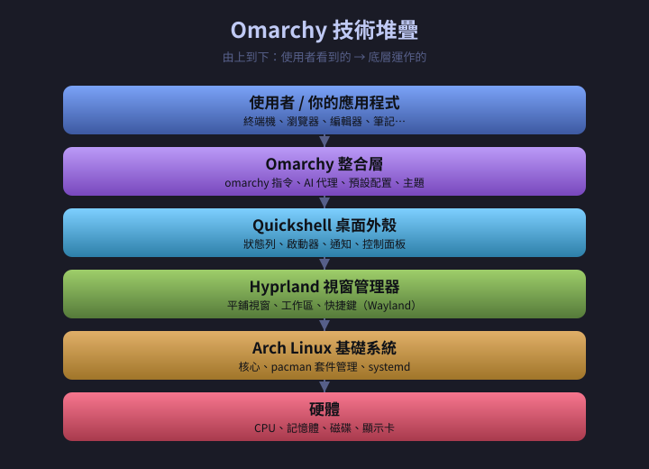

# 第一章　導論：什麼是 Omarchy

> 上一章：[00-前言與目錄.md](00-前言與目錄.md)　|　下一章：[02-安裝與基本操作.md](02-安裝與基本操作.md)

---

## 1.1　先講結論：Omarchy 是什麼？

**一句話版本：**

> Omarchy 是一套「已經幫你設定好、開機就能用、還內建 AI 助理」的 Linux 作業系統。

**更完整一點：**

Omarchy 由 **David Heinemeier Hansson**（大家叫他 DHH，他是程式框架 Ruby on Rails 的發明者）主導開發。2025 年 6 月第一次發表，官方網站是 <https://omarchy.org/>。

它不是從零打造的新系統，而是把幾個現成的優秀專案**組裝並調校**成一個好用的成品。

### 用「組電腦」來比喻

想像你要組一台電腦：

| 一般人的做法 | Omarchy 的做法 |
|---|---|
| 自己挑主機板、CPU、顯卡 | 直接買一台組好的品牌機 |
| 每個零件找驅動、怕不相容 | 廠商都幫你測好了 |
| 裝完還要調 BIOS、裝系統 | 開機就能用 |
| 花了三天 | 花兩分鐘 |

Omarchy 就是那台「組好的品牌機」。

---

## 1.2　它站在哪些技術的肩膀上？



*圖 1-1：Omarchy 的技術堆疊。越上面越接近使用者，越下面越接近硬體。*

| 底層技術 | 白話解釋 | 生活比喻 |
|---|---|---|
| **Arch Linux** | 輕量、更新快的 Linux 核心系統 | 車子的引擎與底盤 |
| **Hyprland** | 平鋪式視窗管理器，視窗自動排整齊 | 方向盤與排檔 |
| **Quickshell** | 桌面外殼，負責狀態列、選單、通知 | 儀表板與中控螢幕 |
| **Omarchy** | 把上面全部組裝好並調校 | 一台可以開上路的整車 |

### 為什麼要懂這個？

因為以後你上網查資料時，會看到這三個名字。知道誰負責什麼，你才知道**問題該去哪裡找答案**：

- 視窗不會動、快捷鍵失效 → 查 **Hyprland**
- 狀態列不見了、選單打不開 → 查 **Quickshell**
- 套件裝不起來 → 查 **Arch Linux / pacman**
- AI 助理不理你 → 查 **Omarchy / omarchy-ai**

---

## 1.3　Omarchy 的三大特色（附實例）

### 特色一：安裝超快

官方說法：最快 **35 秒** 進桌面，多數電腦 **2 分鐘內**完成。

**對比實例：**

```
傳統 Arch Linux 安裝：
  分割硬碟 → 掛載 → 裝 base → 設定時區 → 設定語系 →
  裝 bootloader → 建使用者 → 裝顯卡驅動 → 裝桌面環境 →
  設定音效 → 設定網路 → 調設定檔 …
  耗時：1～3 小時（新手可能一整天）

Omarchy 安裝：
  插隨身碟 → 開機 → 回答 5 個問題 → 等它跑完
  耗時：約 1~2 分鐘
```

你只需要回答五個問題：**鍵盤語言、時區、帳號密碼、選哪顆硬碟、要不要加密**。

### 特色二：內建開發與日常工具

裝好後打開應用程式選單（`Super + Space`），你會看到這些已經在裡面：

| 軟體 | 它是什麼 | 你什麼時候會用到 |
|---|---|---|
| **Neovim** | 程式碼編輯器 | 寫程式、改設定檔 |
| **Obsidian** | 筆記軟體 | 做筆記、寫日誌、建立知識庫 |
| **Chromium** | 網頁瀏覽器 | 上網（就是 Chrome 的開源版） |
| **Docker** | 容器工具 | 跑資料庫、跑現成服務 |
| **LibreOffice** | 文書套件 | 寫 Word、做 Excel 表格 |
| **Alacritty** | 終端機 | 下指令 |

**為什麼這很重要？**

一般 Linux 裝好後是「空的」，你要自己想辦法裝這些東西，而且每個都要設定。Omarchy 把它們**預先裝好也調好了**。

實際對比：

```bash
# 在一般 Ubuntu 上，你要自己來：
sudo apt install neovim          # 裝編輯器
# ...然後還要自己裝插件、設主題、設定檔…
sudo apt install docker.io       # 裝 Docker
sudo usermod -aG docker $USER    # 還要設權限、重登入
# ...族繁不及備載

# 在 Omarchy 上：已經裝好了，直接打指令就能用
nvim
docker ps
```

### 特色三：內建 AI 代理 ⭐

這是本書的重點，也是 Omarchy 跟其他 Linux 最大的不同。

**什麼是「代理（Agent）」？**

- **一般 AI 聊天機器人**：你問它問題，它給你答案。就這樣。
- **AI 代理**：你給它任務，它會**真的動手做**——讀檔案、改檔案、跑指令、查資料，一步一步完成。

**實例對比：**

```
【聊天機器人】
你：怎麼把 test.py 裡第 10 行的 bug 修掉？
AI：（貼出一段說明）「你可以把第 10 行的 XXX 改成 YYY。」
你：……（還是得自己改）

【AI 代理】
你：幫我把 test.py 的 bug 修掉
AI代理：
  → 讀取 test.py
  → 分析程式碼
  → 找到第 10 行少了括號
  → 直接修改檔案
  → 回報：「已修好第 10 行，要我幫你執行測試嗎？」
```

這就是「代理」的價值：**它會動手，不只是動嘴。**

---

## 1.4　Omarchy 適合誰？

### ✅ 適合你，如果你…

- 完全沒用過 Linux，想找一個「不會一開始就崩潰」的入門系統
- 用過 Windows / macOS，想試試 Linux 但怕太難
- 是開發者，想要一個「開箱即用又漂亮」的環境
- 聽過 AI 助理但不知道能幹嘛，想實際玩玩看

### ❌ 可能不適合你，如果你…

- 需要特定商業軟體（例如只能用 Windows 的 Adobe 系列）
- 需要企業級長期支援（LTS）與保固服務
- 完全不願意碰鍵盤指令（Omarchy 高度依賴快捷鍵操作）

### 如果你不確定，這裡有一個判斷方法

> **你會為了「更快、更順手」而願意花一點時間學新東西嗎？**
> 會 → Omarchy 值得試。
> 不會 → 先用 Ubuntu 或 Linux Mint，那些比較像 Windows。

---

## 1.5　常見誤解（先幫你破除）

**誤解一：Linux 很難，一定會搞壞電腦。**

> 事實：以前是這樣，現在不是。Omarchy 就是為了「不搞壞」而設計的。而且它內建 AI 代理，壞了還能問它怎麼修。

**誤解二：Linux 不能玩遊戲。**

> 事實：現在透過 Steam Proton，絕大多數遊戲都能玩。Omarchy 甚至針對遊戲做了調校（v4.0.4 的更新說明就提到改善遊戲相容性）。

**誤解三：裝 Linux 一定要把 Windows 刪掉。**

> 事實：可以雙系統。開機時選擇進 Windows 或 Omarchy。不過要注意先關掉 Windows 的 BitLocker。

**誤解四：AI 代理就是把資料傳給大公司。**

> 事實：Omarchy 預設以**本地模型**為主，資料留在你電腦。要用遠端 API（如 OpenAI）才需要你主動填金鑰。

---

## 1.6　動手練習

這一章沒有指令要打，但請你做三件小事：

1. **打開官方網站** <https://omarchy.org/>，看看首頁的介紹與截圖，感受一下它的外觀。
2. **看看版本號**：首頁會寫目前的版本（例如 4.0.5）。記下來，因為本書以 4.x 為主。
3. **問自己一個問題**：「我想用它來做什麼？」（寫程式？做筆記？只是好奇？）——帶著這個答案進入下一章。

---

## 1.7　本章重點回顧

- Omarchy = Arch Linux + Hyprland + Quickshell，由 DHH 主導
- 三大特色：**安裝快**、**內建一堆工具**、**內建 AI 代理**
- AI 代理的關鍵差別：**會動手做事**，不只是回答問題
- 適合新手與開發者；高度依賴鍵盤快捷鍵

---

> 下一章：[02-安裝與基本操作.md](02-安裝與基本操作.md) — 我們要把系統真正裝起來。
