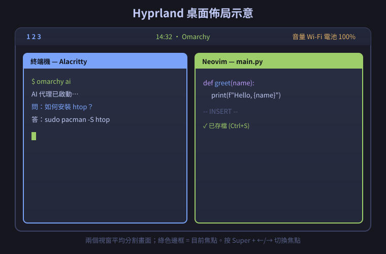

# 第二章　安裝與基本操作

> 上一章：[01-導論.md](01-導論.md)　|　下一章：[03-桌面環境與工作流程.md](03-桌面環境與工作流程.md)

---

## 2.0　本章你會完成什麼

照著做完，你會從「一台空空或裝著 Windows 的電腦」變成「一台跑著 Omarchy、可以下指令的電腦」。


---

## 2.1　安裝前的準備

### 你需要什麼？

| 項目 | 規格 | 說明 |
|---|---|---|
| 電腦 | x86_64（Intel 或 AMD） | Apple M 系列晶片不支援（那是 ARM） |
| USB 隨身碟 | **至少 8 GB** | 裡面資料會被清空 ⚠️ |
| 網路 | 穩定即可 | 安裝時要下載套件，建議有線或穩定 Wi-Fi |
| 硬碟空間 | 至少 30 GB | 建議 60 GB 以上 |

### ⚠️ 一定要先做的事

**1. 備份重要資料**

安裝過程會動到硬碟分割。**整顆重裝的話，資料會全部消失。**

```bash
# 如果你的電腦現在有 Linux，先把家目錄備份到外接硬碟
rsync -av ~/ /media/外接硬碟/備份_$(date +%Y%m%d)/
```

**2. 如果是 Windows 雙系統：關掉 BitLocker**

BitLocker 是 Windows 的磁碟加密。開著的話，安裝後可能無法開機。

操作路徑：`設定` → `隱私權與安全性` → `裝置加密` → 關閉

或是在 PowerShell（系統管理員）執行：

```powershell
manage-bde -status
# 看 Protection Status 是不是 On；是的話要暫停
```

---

## 2.2　下載 ISO 檔

**ISO 檔是什麼？**

> ISO 是「光碟映像檔」。想像你把一整張安裝光碟「壓縮成一個檔案」。寫進 USB 後，USB 就變成一張可開機的安裝光碟。

### 步驟

1. 打開瀏覽器，前往 <https://omarchy.org/>
2. 點 **Download Omarchy**，下載 `omarchy-4.0.5.iso`（約 5–6 GB）
3. 同時下載旁邊的驗證檔：
   - `omarchy-4.0.5.iso.sha256`
   - `omarchy-4.0.5.iso.sig`

### 為什麼要驗證？（用實例解釋）

**SHA-256 校驗** = 檢查檔案有沒有下載完整。

想像你下載一本 500 頁的書，中間少了 3 頁，你根本不會發現。SHA-256 就是「全文指紋」——官方公布指紋，你下載後自己算一次，對得上就代表一個字都沒少。

**GPG 簽章** = 檢查檔案是不是官方發的，有沒有被偷改。

### 怎麼驗證？（實際操作）

```bash
# 切到你的下載資料夾
cd ~/Downloads

# 1. 計算並比對 SHA-256
sha256sum -c omarchy-4.0.5.iso.sha256
```

**你會看到：**

```
omarchy-4.0.5.iso: OK
```

💡 看到 `OK` 就對了。如果看到 `FAILED`，代表下載不完整，請重新下載。

```bash
# 2. 驗證 GPG 簽章（需要先匯入 Omarchy 的公鑰）
gpg --verify omarchy-4.0.5.iso.sig omarchy-4.0.5.iso
```

**你會看到：**

```
gpg: Good signature from "Omarchy <...>"
```

💡 看到 `Good signature` 就代表檔案是真的。

> **小白偷懶方案**：如果你信任 omarchy.org，也可以跳過驗證。但建議至少做 SHA-256 那一項，因為下載中斷很常見。

---

## 2.3　把 ISO 寫進 USB 隨身碟

### 先找到你的隨身碟代號

**Windows**：打開「磁碟管理」，看隨身碟的磁碟編號（例如磁碟 1）。
**Linux / macOS**：

```bash
lsblk
```

**你會看到類似：**

```
NAME   MAJ:MIN RM   SIZE RO TYPE MOUNTPOINTS
sda      8:0    0 476.9G  0 disk
├─sda1   8:1    0   512M  0 part /boot
└─sda2   8:2    0 476.4G  0 part /
sdb      8:16   1  14.9G  0 disk          ← 這個是隨身碟（14.9G）
└─sdb1   8:17   1  14.9G  0 part /run/media/...
```

⚠️ **關鍵判斷**：看 `SIZE` 跟你的隨身碟容量一樣的那一個，就是它。上面的例子隨身碟是 `/dev/sdb`。

> **用容量判斷最準**，不要用 `/dev/sda`、`/dev/sdb` 的名字猜，因為每次插拔都可能變。

### 方法 A：用 balenaEtcher（Windows / macOS，最簡單）

1. 下載並安裝 **balenaEtcher**
2. 打開，點 **Flash from file**，選你的 `.iso`
3. 點 **Select target**，選你的 USB
4. 點 **Flash!**
5. 等它跑完，看到 **Flash Complete!** 就好

💡 圖形介面最不容易出錯，新手推薦這個。

### 方法 B：用 caligula（Linux）

```bash
# 寫入（把 /dev/sdX 換成你的隨身碟，例如 /dev/sdb）
caligula burn omarchy-4.0.5.iso /dev/sdX
```

### 方法 C：用 dd（Linux，最原始但一定有）

```bash
# 先卸載隨身碟（非常重要，否則可能寫入失敗）
sudo umount /dev/sdb1

# 寫入（if=輸入, of=輸出）
sudo dd if=omarchy-4.0.5.iso of=/dev/sdb bs=4M status=progress oflag=sync
```

**你會看到進度：**

```
1073741824 bytes (1.1 GB, 1.0 GiB) copied, 12 s, 89 MB/s
```

⚠️ **警告**：`of=/dev/sdb` 的 `sdb` 選錯會**清空你整顆硬碟**。請務必用 `lsblk` 反覆確認容量。

---

## 2.4　開機與安裝

### 步驟 1：從 USB 開機

1. 把隨身碟插進電腦
2. **重新開機**，在出現品牌 Logo 的瞬間，連按開機選單鍵：

| 品牌 | 常見按鍵 |
|---|---|
| ASUS | `F2` 或 `Del` |
| Acer | `F2` 或 `Del` |
| Lenovo | `F1`、`F2` 或 `F12` |
| Dell | `F2` 或 `F12` |
| HP | `F10` 或 `Esc` |
| 微星 MSI | `Del` |
| 技嘉 Gigabyte | `Del` |

3. 進入 BIOS/UEFI 後：
   - 關閉 **Secure Boot**（安全開機）
   - 把 USB 設為第一開機順序
4. 儲存並離開（通常是 `F10`）

### 步驟 2：回答五個問題

開機後會進入 Omarchy 的安裝畫面，依序問你：

| # | 問題 | 建議回答 | 說明 |
|---|---|---|---|
| 1 | 鍵盤語言 | `Traditional Chinese (Taiwan)` | 影響打字對不對 |
| 2 | 時區 | `Asia/Taipei` | 影響時間顯示 |
| 3 | 使用者名稱與密碼 | 例如 `jackjean` | **這個帳號就是你的系統管理員** |
| 4 | 選哪顆硬碟 | 看容量選對的那顆 | ⚠️ 選錯會清空資料 |
| 5 | 是否全磁碟加密 | 新手可先選「否」 | 選「是」每次開機要多打一次密碼 |

💡 **密碼建議**：至少 8 個字元，英文數字混合。系統會用它來執行 `sudo`（管理員權限）。

### 步驟 3：等它自動安裝

之後**你什麼都不用做**。安裝程式會：
- 從網路下載套件
- 建立檔案系統
- 安裝桌面環境
- 設定驅動

最快的機器不到一分鐘，老電腦可能 5 分鐘。看到「完成，請重新開機」就成功了。

---

## 2.5　第一次登入

重開機後（記得拔掉隨身碟），你會看到登入畫面。

```
┌────────────────────────────────┐
│                                │
│            Omarchy             │
│                                │
│      使用者：[jackjean      ]  │
│      密碼：  [••••••••      ]  │
│                                │
│            [ Enter ]           │
└────────────────────────────────┘
```

1. 輸入帳號（可能已經幫你填好）
2. 輸入密碼
3. 按 Enter

⚠️ **打密碼時畫面不會顯示任何字元**（連星星都沒有），這是正常的安全設計，不是卡住。打完直接 Enter。

---

## 2.6　桌面導覽：你看到的東西叫什麼



*圖 2-1：Omarchy 桌面的樣子。頂部一條是狀態列，下面是自動排列的視窗。*

| 區域 | 名稱 | 功能 |
|---|---|---|
| 最上面那條 | 狀態列（Quickshell） | 時間、音量、網路、電池 |
| 中間空白處 | 桌面 | 放視窗的地方 |
| 左上角數字 | 工作區指示器 | 顯示你在第幾桌 |

### 三個一定要記住的快捷鍵

| 快捷鍵 | 功能 | 什麼時候用 |
|---|---|---|
| `Super + Enter` | 開終端機 | 要下指令時 |
| `Super + Space` | 開應用程式選單 | 要開程式時 |
| `Super + 1…9` | 切換工作區 | 要分開不同工作時 |

💡 `Super` 鍵就是鍵盤左下角的 **Windows 標誌鍵**（Mac 鍵盤上是 Command 鍵的位置）。

---

## 2.7　什麼是「平鋪式」？（實例說明）

這是新手最不習慣的地方，但懂了之後你會愛上。

### 堆疊式（Windows / macOS）

```
開 3 個視窗後：
┌──────────────────────────┐
│  ┌────────────────────┐  │
│  │  ③ 最上層可見       │  │
│  │  ┌──────────────┐  │  │
│  │  │ ② 被蓋住     │  │  │
│  │  │  ┌────────┐  │  │  │
│  │  │  │① 被蓋住 │  │  │  │
│  │  │  └────────┘  │  │  │
│  │  └──────────────┘  │  │
│  └────────────────────┘  │
└──────────────────────────┘
  要一直拖動、縮放、Alt+Tab 找視窗
```

### 平鋪式（Omarchy / Hyprland）

```
開 3 個視窗後：
┌──────────────────────────┐
│  ┌─────────┐ ┌─────────┐ │
│  │ ① 終端  │ │ ② 瀏覽  │ │
│  │         │ │         │ │
│  └─────────┘ └─────────┘ │
│  ┌─────────────────────┐ │
│  │  ③ 編輯器            │ │
│  └─────────────────────┘ │
└──────────────────────────┘
  自動排好，不重疊，不浪費空間
```

### 實際體驗

```bash
# 按 Super + Enter 開第一個終端機 → 佔滿畫面
# 再按 Super + Enter 開第二個    → 變成左右各一半
# 再按 Super + Enter 開第三個    → 變成三塊
# 按 Super + Q 關掉當前視窗     → 剩下的自動重新排好
```

💡 習慣之後，你的手幾乎不用離開鍵盤，效率會高很多。

---

## 2.8　認識終端機（Pacman 套件管理）

### 打開終端機

按 `Super + Enter`，會跳出深色視窗，這是 **Alacritty**。

畫面大概長這樣：

```
jackjean@omarchy ~ $
```

| 部分 | 意思 |
|---|---|
| `jackjean` | 你的使用者名稱 |
| `omarchy` | 電腦名稱 |
| `~` | 你現在在家目錄 |
| `$` | 準備好接受指令了 |

### 什麼是 Pacman？

Pacman 是 Arch Linux 的**套件管理器**，也就是「應用程式商店」的指令版。

| 你想做的事 | 指令 |
|---|---|
| 更新整個系統 | `sudo pacman -Syu` |
| 安裝軟體 | `sudo pacman -S 套件名` |
| 移除軟體 | `sudo pacman -Rns 套件名` |
| 搜尋軟體 | `pacman -Ss 關鍵字` |

⚠️ 前面的 `sudo` 意思是「用管理員權限執行」，會要你輸入密碼。

### 實例 1：更新系統

```bash
sudo pacman -Syu
```

**你會看到：**

```
:: Synchronizing package databases...
 core is up to date
 extra is up to date
:: Starting full system upgrade...
resolving dependencies...
Packages (3) linux-6.x.x-1  neovim-0.x.x-1  ...
Total Download Size:   45.20 MiB
Proceed with installation? [Y/n]
```

輸入 `Y` 再按 Enter。等它跑完就更新好了。

💡 **多久更新一次？** 建議每週一次。Arch 是滾動更新，放太久不更新反而容易出問題。

### 實例 2：安裝一個小工具

我們來裝 `cowsay`——一個會讓牛說話的搞笑程式，用來測試安裝流程。

```bash
sudo pacman -S cowsay
```

安裝完後執行：

```bash
cowsay 你好，Omarchy
```

**你會看到：**

```
 ___________________
< 你好，Omarchy >
 -------------------
        \   ^__^
         \  (oo)\_______
            (__)\       )\/\
                ||----w |
                ||     ||
```

恭喜，你剛剛成功安裝了一個軟體！

### 實例 3：搜尋套件

不確定套件叫什麼名字？先搜尋：

```bash
pacman -Ss python
```

**你會看到一長串結果：**

```
extra/python 3.13.0-1
    High-level scripting language
extra/python-pip 24.0-1
    The PyPA recommended tool for installing Python packages
extra/python-requests 2.32.0-1
    Python HTTP for Humans
...
```

💡 找到你要的，再用 `sudo pacman -S 套件名` 安裝。

### 實例 4：移除套件

```bash
sudo pacman -Rns cowsay
```

| 參數 | 意思 |
|---|---|
| `-R` | Remove，移除 |
| `-n` | 不保留設定檔 |
| `-s` | 同時移除沒人用的相依套件 |

---

## 2.9　三個終端機救命技巧

### 技巧 1：Tab 自動補全

打到一半按 `Tab`，會自動補完。

```bash
# 打這樣然後按 Tab
cd Doc[Tab]
# 會自動變成
cd Documents/
```

如果按 Tab 沒反應，代表有不只一個符合的選項，再按一次 Tab 會列出所有可能。

### 技巧 2：↑ 上方向鍵

按 `↑` 會叫出上一個指令，可以一直往上翻歷史紀錄。

```bash
# 你剛剛打了 sudo pacman -S cowsay
# 現在按 ↑ 就會出現
sudo pacman -S cowsay
```

### 技巧 3：Ctrl + C 中斷

程式卡住、跑太久，按 `Ctrl + C` 強制中斷。

```bash
# 例如不小心執行了會卡住的程式
ping google.com
# 看到一串回應一直跳，按 Ctrl + C 停止
```

---

## 2.10　Omarchy 專屬指令

除了系統指令，Omarchy 還提供自己的指令 `omarchy`。

```bash
omarchy
```

**你會看到可用子指令列表：**

```
Usage: omarchy <command>

Commands:
  version     顯示版本
  theme       切換主題
  update      更新 Omarchy
  ...
```

試試看：

```bash
omarchy version
```

**你會看到：**

```
Omarchy 4.0.5
```

---

## 2.11　常見錯誤排解

### 問題：開機後黑畫面

**可能原因**：顯卡驅動不相容（尤其是 NVIDIA）。

**解法**：在開機選單按 `e` 編輯，在 `linux` 那行結尾加上 `nomodeset`，按 `Ctrl+X` 開機。

### 問題：`sudo: command not found`

**原因**：打錯字，或該套件沒裝。

**解法**：用 Tab 補全，或 `pacman -Ss 關鍵字` 找正確名稱。

### 問題：`error: failed to commit transaction (conflicting files)`

**原因**：檔案衝突，通常是有檔案不屬於任何套件。

**解法**：

```bash
# 看是哪個檔案衝突，然後強制覆蓋（小心使用）
sudo pacman -S 套件名 --overwrite '*'
```

### 問題：忘記 sudo 密碼

**解法**：重開機，在開機選單選 recovery 模式，用 `passwd 使用者名稱` 重設。

---

## 2.12　動手練習

1. 打開終端機（`Super + Enter`）
2. 執行 `sudo pacman -Syu` 更新系統
3. 安裝 `cowsay`：`sudo pacman -S cowsay`
4. 執行 `cowsay 我是 Omarchy 新手`
5. 執行 `omarchy version` 看版本
6. 用 `↑` 叫回上一行指令，再執行一次
7. 用 `Ctrl + C` 中斷 `ping google.com`

---

## 2.13　本章重點回顧

- 安裝三階段：**下載驗證 ISO → 寫入 USB → 開機回答 5 題**
- 桌面核心快捷鍵：`Super + Enter`、`Super + Space`、`Super + 1…9`
- 平鋪式：視窗自動排列，不重疊
- Pacman 四招：`-Syu` 更新、`-S` 安裝、`-Rns` 移除、`-Ss` 搜尋
- 三個救命鍵：`Tab`、`↑`、`Ctrl + C`

---

> 下一章：[03-桌面環境與工作流程.md](03-桌面環境與工作流程.md) — 學會操作視窗與工作區。
