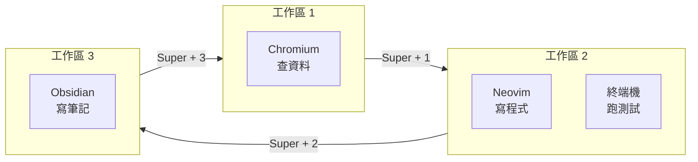

# 第三章　桌面環境與工作流程

> 上一章：[02-安裝與基本操作.md](02-安裝與基本操作.md)　|　下一章：[04-內建軟體介紹.md](04-內建軟體介紹.md)

---

## 3.0　本章目標

學會用**鍵盤**操作視窗，而不是滑鼠。這是 Omarchy 最重要的工作方式。


---

## 3.1　視窗管理：Hyprland 的核心概念

### 概念一：視窗不會「浮」在別人上面

在 Windows，視窗像紙張疊在桌上。在 Hyprland，視窗像磁磚**貼滿整面牆**，不會互相遮擋。

**為什麼這樣設計？**

因為你**永遠看得見所有視窗**，不用 Alt+Tab 猜哪個在哪。代價是：你要用鍵盤告訴它「視窗要怎麼排」。

### 概念二：焦點（Focus）

同一時間只有一個視窗「有焦點」——你的鍵盤輸入會送給它。有焦點的視窗會有**不同顏色的邊框**。

```
┌─────────────┬─────────────┐
│  終端機     │  瀏覽器     │  ← 藍色邊框 = 有焦點
│  （藍框）   │  （灰框）   │
└─────────────┴─────────────┘
   你的打字會進到這裡
```

### 概念三：工作區（Workspace）

工作區 = 多張「虛擬桌子」。每張桌子可以放不同的視窗。



*圖 3-1：把不同工作分到不同工作區，切換超快。*

**實際差異：**

```
【不用工作區】
開了 12 個視窗擠在一張桌面 → 找不到東西、雜亂

【用工作區】
工作區 1：只放瀏覽器（查資料）
工作區 2：只放編輯器 + 終端機（寫程式）
工作區 3：只放筆記
按一個鍵就切換 → 大腦不用切換情境
```

💡 **建議的工作區規劃**（可以照抄）：

| 工作區 | 用途 |
|---|---|
| 1 | 瀏覽器（查資料、看文件） |
| 2 | 編輯器 + 終端機（主要工作） |
| 3 | 筆記（Obsidian） |
| 4 | 通訊（Email、聊天） |
| 5 | 娛樂（音樂、影片） |

---

## 3.2　全部快捷鍵（附使用情境）

### 應用程式

| 快捷鍵 | 功能 | 實際情境 |
|---|---|---|
| `Super + Enter` | 開終端機 | 想下指令 |
| `Super + Space` | 開程式選單 | 想開某個程式 |

### 視窗操作

| 快捷鍵 | 功能 | 實際情境 |
|---|---|---|
| `Super + Q` | 關閉當前視窗 | 用完的視窗關掉 |
| `Super + F` | 全螢幕切換 | 看影片、簡報 |
| `Super + V` | 切換浮動模式 | 需要視窗疊在一起時 |
| `Super + ←/→/↑/↓` | 移動焦點 | 切到隔壁視窗 |
| `Super + Shift + ←/→` | 移動視窗位置 | 把視窗換左右 |
| `Super + Ctrl + ←/→` | 調整視窗大小 | 讓某個視窗大一點 |

### 工作區

| 快捷鍵 | 功能 |
|---|---|
| `Super + 1…9` | 切換到第 N 個工作區 |
| `Super + Shift + 1…9` | 把當前視窗搬到第 N 個工作區 |
| `Super + Tab` | 切到上一個工作區 |

### 系統

| 快捷鍵 | 功能 |
|---|---|
| `Super + Alt + Space` | 開 Omarchy 主選單 |
| `Super + A` | 開 AI 代理 ⭐ |
| `Super + L` | 鎖定螢幕 |

---

## 3.3　實作演練：一步步做出「程式開發桌面」

讓我們實際操作一次，把工作區 2 佈置成寫程式的環境。

### 步驟 1：切到工作區 2

按 `Super + 2`。左上角指示器會顯示 `2`。

### 步驟 2：開終端機

按 `Super + Enter`。終端機佔滿整個工作區。

```
┌────────────────────────────┐
│ jackjean@omarchy ~ $       │
│                            │
│                            │
└────────────────────────────┘
```

### 步驟 3：開編輯器

按 `Super + Enter` 再開一個終端機，然後在其中一個輸入：

```bash
nvim hello.py
```

畫面變成左右各一半：

```
┌─────────────┬─────────────┐
│ 終端機      │ Neovim      │
│ $           │ hello.py    │
│             │ ~           │
│             │ ~           │
└─────────────┴─────────────┘
```

### 步驟 4：寫一行程式

在 Neovim 裡：
1. 按 `i` 進入編輯模式（左下角會顯示 `-- INSERT --`）
2. 輸入：

```python
print("Hello, Omarchy!")
```

3. 按 `Esc` 回一般模式
4. 輸入 `:w` 然後 Enter（存檔）
5. 輸入 `:q` 然後 Enter（離開）

### 步驟 5：切回終端機執行

按 `Super + ←` 把焦點移到終端機，然後輸入：

```bash
python hello.py
```

**你會看到：**

```
Hello, Omarchy!
```

🎉 你剛剛完成了一個完整的「寫程式 → 存檔 → 執行」流程，而且用了兩個平鋪視窗。

### 步驟 6：切到別的工作區再切回來

```bash
# 按 Super + 1 去看瀏覽器（假設你開了一個）
# 按 Super + 2 回來 —— 你的佈置完全保留！
```

這就是工作區的威力：**切換不打亂你的佈置**。

---

## 3.4　Quickshell：狀態列與啟動器

### 狀態列（最上面那條）

```
┌────────────────────────────────────────────────┐
│ 1  2  3        14:32  2026-10-19      🔊  📶  🔋 │
└────────────────────────────────────────────────┘
  ↑工作區        ↑時間                 ↑音量 ↑網路 ↑電池
```

有些面板可以**點擊**操作：

- 點時間 → 打開日曆
- 點音量 → 調整音量
- 點網路 → 切換 Wi-Fi

### 應用程式啟動器

按 `Super + Space`，會出現搜尋框：

```
┌────────────────────────────────┐
│ 搜尋： [term_               ]  │
├────────────────────────────────┤
│ ▸ 終端機 (Alacritty)           │
│ ▸ 終端機 (Foot)                │
└────────────────────────────────┘
```

**實例：**

| 你輸入 | 會找到 |
|---|---|
| `term` | 終端機 |
| `chrome` 或 `chrom` | Chromium |
| `obs` | Obsidian 或 OBS Studio |
| `nvim` | Neovim |
| `calc` | 計算機（Omacalc） |

按 `↑`/`↓` 選擇，按 `Enter` 開啟。

💡 **提示**：不用打全名，打幾個字母就好。這是「模糊搜尋」。

### Omarchy 主選單

按 `Super + Alt + Space`，會打開 Omarchy 專屬選單，裡面有：

- **Theme**：換主題
- **Update**：更新系統
- **Setup**：重新設定
- **Reset Computer**：回復原廠設定

---

## 3.5　主題與外觀

Omarchy 內建多種主題，換一個就整個系統變色。

```bash
omarchy theme
```

**你會看到列表：**

```
Available themes:
  1) Tokyo Night
  2) Solitude
  3) Last Horizon
  4) Lupine
  ...
Select theme:
```

選一個數字按 Enter，**整個系統**（終端機、狀態列、應用程式）會一起換色。

### 為什麼「主題連動」很重要？

大多數 Linux 系統，你要自己一個一個設定：終端機一個主題、狀態列一個主題、編輯器一個主題……顏色還不一定搭。

Omarchy 做的是：**選一個主題，全部一起換**，而且顏色是設計過的。

**實例對比：**

```
【傳統做法】
換終端機主題 → 編輯 ~/.config/alacritty/alacritty.toml
換狀態列主題 → 編輯 ~/.config/waybar/style.css
換編輯器主題 → 編輯 ~/.config/nvim/init.lua
…每個都要手動改，還可能不搭

【Omarchy】
omarchy theme → 選一個 → 全部完成
```

---

## 3.6　自訂快捷鍵

### 找到設定檔

```bash
nvim ~/.config/hypr/hyprland.conf
```

### 看懂格式

設定檔裡會有很多像這樣的行：

```
bind = SUPER, Q, killactive
bind = SUPER, RETURN, exec, alacritty
bind = SUPER, SPACE, exec, omarchy-menu
```

格式是：

```
bind = 修飾鍵, 按鍵, 動作
```

| 部分 | 意思 |
|---|---|
| `SUPER` | 要按著的修飾鍵（Windows 鍵） |
| `Q` | 要按的鍵 |
| `killactive` | 要做的事（關閉視窗） |

### 實例：把開終端機改成 Super + T

原本是 `Super + Enter`，改成 `Super + T`：

```
# 找到這行
bind = SUPER, RETURN, exec, alacritty

# 改成
bind = SUPER, T, exec, alacritty
```

存檔後，重新載入設定：

```bash
hyprctl reload
```

現在按 `Super + T` 就會開終端機了。

### 實例：加一個「開瀏覽器」的快捷鍵

在設定檔最後加一行：

```
bind = SUPER, B, exec, chromium
```

`hyprctl reload` 之後，按 `Super + B` 就會開 Chromium。

💡 **注意**：改設定檔前建議先備份：

```bash
cp ~/.config/hypr/hyprland.conf ~/.config/hypr/hyprland.conf.bak
```

---

## 3.7　常見問題

### Q：視窗卡住了，關不掉怎麼辦？

```bash
# 在終端機執行，按一下要關的視窗
hyprctl kill
```

或按 `Super + Q` 多試幾次。

### Q：不小心把視窗搬到別的工作區，找不回來？

按 `Super + Shift + 1…9` 逐一檢查，或用：

```bash
hyprctl clients
```

會列出所有視窗，包含它們在哪個工作區。

### Q：快捷鍵完全沒反應？

**先確認**：你按的是 `Super` 鍵（Windows 標誌鍵），不是 `Ctrl` 或 `Alt`。

**再確認**：設定檔有沒有語法錯誤：

```bash
hyprctl reload
```

如果設定檔有錯，這裡會顯示錯誤訊息。

---

## 3.8　動手練習

1. 用 `Super + 1` 到工作區 1，開一個 Chromium（`Super + Space` 搜尋 `chromium`）
2. 用 `Super + 2` 到工作區 2，按 `Super + Enter` 開兩個終端機
3. 在其中一個執行 `nvim test.py`，寫 `print("練習")`，存檔離開
4. 另一個終端機執行 `python test.py`
5. 按 `Super + 3` 開 Obsidian，建立一則筆記
6. 用 `Super + 1/2/3` 來回切換，確認佈置都保留
7. 執行 `omarchy theme` 換一個主題
8. 把開終端機的快捷鍵改成 `Super + T`，測試看看

---

## 3.9　本章重點回顧

- 平鋪式：視窗自動排列，用鍵盤操作
- 工作區：多張虛擬桌子，用 `Super + 數字` 切換
- 核心快捷鍵：`Enter` 開終端機、`Space` 開選單、`Q` 關視窗、方向鍵移動焦點
- Quickshell 負責狀態列與啟動器，部分可點擊
- `omarchy theme` 一鍵換全系統主題
- 快捷鍵設定檔在 `~/.config/hypr/hyprland.conf`

---

> 下一章：[04-內建軟體介紹.md](04-內建軟體介紹.md) — 來看看系統裡有哪些現成工具。
