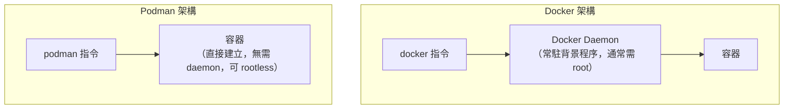
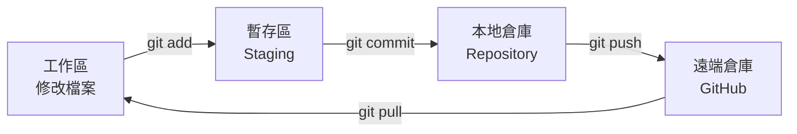

# 第四章　內建軟體介紹

> 上一章：[03-桌面環境與工作流程.md](03-桌面環境與工作流程.md)　|　下一章：[05-內建AI代理.md](05-內建AI代理.md)

---

## 4.0　為什麼要認識內建軟體？

因為**它們已經裝好了**。你不用花時間研究「該裝哪個編輯器」「該用哪個筆記軟體」，直接開始用就好。

本章每個軟體都會給你：
- 這是什麼（白話）
- 什麼時候用
- 實際操作範例

---

## 4.1　開發工具三本柱

### 4.1.1　Neovim（程式碼編輯器）

**這是什麼？**

一個全鍵盤操作的文字編輯器。看起來很樸素，但裝了 **LazyVim** 設定後，功能跟付費 IDE 差不多。

**為什麼不用 VS Code？**

| 比較 | Neovim | VS Code |
|---|---|---|
| 啟動速度 | 幾乎瞬間 | 要等幾秒 |
| 記憶體 | 少 | 較多 |
| 操作方式 | 全鍵盤 | 滑鼠+鍵盤 |
| 學習曲線 | 陡 | 平緩 |

💡 **新手建議**：先用 Neovim 寫簡單檔案，習慣它的模式；真的受不了再用 `yay -S visual-studio-code-bin` 裝 VS Code。

**實際操作：建立並執行一個 Python 檔**

```bash
nvim hello.py
```

進去後：

| 步驟 | 按鍵 | 畫面反應 |
|---|---|---|
| 1. 進入編輯模式 | `i` | 左下角顯示 `-- INSERT --` |
| 2. 輸入程式 | 打字 | 文字出現在畫面 |
| 3. 回一般模式 | `Esc` | `-- INSERT --` 消失 |
| 4. 存檔 | `:w` + Enter | 下方顯示 `"hello.py" written` |
| 5. 離開 | `:q` + Enter | 回到終端機 |

程式內容：

```python
def greet(name):
    return f"Hello, {name}!"

print(greet("Omarchy"))
```

執行：

```bash
python hello.py
```

**你會看到：**

```
Hello, Omarchy!
```

### 4.1.2　Obsidian（筆記軟體）

**這是什麼？**

用 Markdown 格式寫筆記的軟體。最大特色是筆記之間可以互相連結，形成「知識網路」。

**什麼時候用？**

- 寫學習筆記
- 記錄工作專案
- 整理讀書心得
- 寫日誌

**實際操作：建立你的第一個筆記庫**

1. 打開 Obsidian（`Super + Space` → 輸入 `obsidian`）
2. 點 **Create new vault**
3. 命名為 `我的筆記`，選一個位置（例如 `~/Documents/我的筆記`）
4. 點 **Create**

**建立第一則筆記：**

1. 按 `Ctrl + N` 開新筆記
2. 命名為 `Omarchy 學習筆記`
3. 輸入內容：

```markdown
# Omarchy 學習筆記

## 今天學到
- 安裝了 Omarchy
- 學會用 [[Pacman]] 安裝軟體
- 試用了 [[AI 代理]]

## 待辦
- [ ] 學會 Hyprland 快捷鍵
- [ ] 寫第一個 Python 程式
```

**神奇的 `[[ ]]` 連結：**

當你打 `[[Pacman]]`，Obsidian 會：
- 自動建立一則叫「Pacman」的筆記（如果不存在）
- 在兩則筆記之間建立連結
- 在「知識圖譜」中顯示成一個節點

按 `Ctrl + G` 可以看到知識圖譜，你的筆記會變成一張網狀圖。

💡 **比喻**：一般筆記本像「一疊紙」，Obsidian 像「一張蜘蛛網」——每則筆記都跟其他筆記有連結，找資料時可以沿著連結跳來跳去。

### 4.1.3　Chromium（網頁瀏覽器）

**這是什麼？**

Chrome 的開源版本。操作、介面幾乎一樣。

**什麼時候用？**

- 上網查資料
- 測試自己寫的網頁
- 用網路應用（Gmail、Notion 等）

**開發者功能（實用）：**

按 `F12` 打開開發者工具，可以：
- 看網頁的 HTML/CSS
- 看 Console 的錯誤訊息
- 看 Network 請求和回應
- 測試手機版畫面（點左上角手機圖示）

**實例：測試你的網頁**

假設你用 Python 起了一個本機伺服器：

```bash
python -m http.server 8000
```

然後在 Chromium 打開 `http://localhost:8000`，就能看到你的網頁。

---

## 4.2　容器工具：Docker 與 Podman

### 4.2.1　Docker 是什麼？

**用最白話的方式解釋：**

> Docker 讓你把「一個程式 + 它需要的所有環境」打包成一個盒子。這個盒子拿到任何電腦上，都能用一模一樣的方式跑起來。

**為什麼需要它？**

經典問題：**「在我的電腦上可以跑，在你的電腦上就不行。」**

原因通常是：
- 你的 Python 是 3.11，他是 3.9
- 你裝了某個套件，他沒裝
- 系統函式庫版本不同

Docker 把這些全部包進去，消除差異。


*圖 4-1：Docker 的三個階段——程式碼 → 映像檔 → 容器。*

**比喻：**

- **Dockerfile** = 食譜
- **映像檔（Image）** = 冷凍調理包（照食譜做好、封裝好）
- **容器（Container）** = 加熱後的那一餐（正在跑）

你可以用同一份調理包（映像檔），同時加熱三份（容器）。

### 4.2.2　Docker 實例：跑一個網頁伺服器

```bash
# 跑一個 nginx 網頁伺服器，對應到本機 8080 埠
docker run -d -p 8080:80 --name my-web nginx
```

**參數解釋：**

| 參數 | 意思 |
|---|---|
| `-d` | 在背景執行（detached） |
| `-p 8080:80` | 把本機的 8080 埠對應到容器的 80 埠 |
| `--name my-web` | 幫這個容器取名 |
| `nginx` | 要用的映像檔名稱 |

**你會看到：**

```
Unable to find image 'nginx:latest' locally
latest: Pulling from library/nginx
...
Status: Downloaded newer image for nginx:latest
a3f8e2c1b9d7...
```

那串亂碼是容器 ID。

**驗證它真的在跑：**

```bash
docker ps
```

**你會看到：**

```
CONTAINER ID   IMAGE   COMMAND                  STATUS         PORTS                  NAMES
a3f8e2c1b9d7   nginx   "/docker-entrypoint.…"   Up 30 seconds  0.0.0.0:8080->80/tcp   my-web
```

然後在瀏覽器打開 `http://localhost:8080`，你會看到 nginx 的歡迎頁面。

**停掉並刪除：**

```bash
docker stop my-web      # 停止
docker rm my-web        # 刪除容器
```

### 4.2.3　Docker Compose：一次跑多個服務

實際專案通常需要多個服務（例如：網頁 + 資料庫）。用 `docker-compose.yml` 描述：

```yaml
version: '3'
services:
  web:
    image: nginx
    ports:
      - "8080:80"
  db:
    image: postgres
    environment:
      POSTGRES_PASSWORD: mypassword
    volumes:
      - db-data:/var/lib/postgresql/data

volumes:
  db-data:
```

啟動：

```bash
docker compose up -d
```

**你會看到：**

```
[+] Running 3/3
 ✔ Network myapp_default  Created
 ✔ Container myapp-db-1   Started
 ✔ Container myapp-web-1  Started
```

停止：

```bash
docker compose down
```

### 4.2.4　Podman：更安全的選擇

**差別在哪？**



*圖 4-2：Docker 需要一個常駐的 daemon（而且通常是 root）；Podman 不需要，安全性更好。*

**指令幾乎相同：**

```bash
# Docker 寫法
docker run -d -p 8080:80 nginx

# Podman 寫法（一字之差）
podman run -d -p 8080:80 nginx
```

💡 **怎麼選？**
- 想學業界標準 → 用 **Docker**
- 重視安全、不想要 root daemon → 用 **Podman**
- 兩者其實可以並存

---

## 4.3　終端機三寶：Alacritty、tmux、zsh

### 4.3.1　Alacritty（終端機）

Omarchy 的預設終端機。用 GPU 加速，捲動和顯示都很快。

```bash
# 檢查版本
alacritty --version
```

### 4.3.2　tmux（終端機多工器）

**問題情境：**

你 SSH 連到遠端伺服器跑一個要 3 小時的程式，結果網路斷了，程式也被中斷。

**tmux 解決這個問題：**

```bash
# 建立一個叫 work 的 session
tmux new -s work

# ...在裡面跑你的程式...

# 按 Ctrl+b 然後按 d  ← 這叫 detach，暫時離開
# 程式仍在背景跑！

# 之後重新接回來
tmux attach -t work
```

**窗格分割：**

```bash
# 先按 Ctrl+b，然後：
#   %    → 左右分割
#   "    → 上下分割
#   方向鍵 → 切換窗格
#   x    → 關閉窗格
```

**實際畫面：**

```
┌─────────────────┬─────────────────┐
│ 窗格 1          │ 窗格 2          │
│ $ npm run dev   │ $ tail -f log   │
│ 伺服器啟動中…   │ [12:30] GET /   │
│                 │ [12:31] GET /x  │
└─────────────────┴─────────────────┘
┌───────────────────────────────────┐
│ 窗格 3                            │
│ $ git status                      │
└───────────────────────────────────┘
```

💡 **常用指令：**

| 指令 | 功能 |
|---|---|
| `tmux new -s 名稱` | 建立 session |
| `tmux ls` | 列出所有 session |
| `tmux attach -t 名稱` | 接回 session |
| `tmux kill-session -t 名稱` | 刪除 session |

### 4.3.3　zsh + Oh My Zsh（Shell）

**Shell 是什麼？**

Shell 是「你跟系統之間的翻譯」。你打指令，它幫你轉成系統聽得懂的話。Omarchy 用的 shell 是 **zsh**。

**Oh My Zsh 加了什麼？**

| 功能 | 實際效果 |
|---|---|
| 彩色提示字元 | 顯示當前目錄、Git 分支、狀態 |
| 自動補全 | 打一半按 Tab 就補完 |
| 別名（alias） | `ll` = `ls -la` |
| 插件系統 | 可加 Git、Docker 等自動補全 |

**提示字元範例：**

```
~/Work/myproject  main ✚2  $
   ↑當前目錄      ↑Git分支 ↑有2個變更
```

一眼就知道自己在哪、專案狀態如何。

**實際操作：試試別名**

```bash
ll
```

等於：

```bash
ls -la
```

---

## 4.4　系統工具

### 4.4.1　Herdr（系統監控）

Omarchy 內建的系統監控工具，整合了資源監控與服務管理。

```bash
herdr
```

它會顯示：
- CPU、記憶體使用率
- 正在執行的程序
- systemd 服務狀態

### 4.4.2　Btop（資源監控）

視覺化的資源監控工具，畫面很漂亮。

```bash
btop
```

**你會看到：**

```
┌─ CPU ──────────────────────────────────┐
│ ▁▂▃▅▇█▇▅▃▂▁▂▃▅▇  12%  8 cores          │
├─ Mem ──────────────────────────────────┤
│ ████████░░░░░░░░  6.2G / 16G  (39%)    │
├─ Net ──────────────────────────────────┤
│ ↓ 1.2 MB/s   ↑ 340 KB/s                │
└────────────────────────────────────────┘
```

按 `q` 離開。

**什麼時候用？**

- 電腦變慢，想找出誰在吃資源
- 想確認記憶體夠不夠
- 想看網路流量

### 4.4.3　Git（版本控制）

**這是什麼？**

Git 幫你記錄程式碼的每一次修改，可以隨時回退到任何一個版本。

**比喻：** 像遊戲的「存檔點」。你可以一直存檔，玩壞了就讀取上一個存檔。



*圖 4-3：Git 的四個區域。修改從左流到右，最後推上雲端。*

**實例：從零建立一個專案**

```bash
# 1. 建立專案資料夾
mkdir myproject
cd myproject

# 2. 初始化 Git
git init
```

**你會看到：**

```
Initialized empty Git repository in /home/jackjean/myproject/.git/
```

```bash
# 3. 建立一個檔案
echo "print('hello')" > main.py

# 4. 看狀態
git status
```

**你會看到：**

```
On branch main
No commits yet
Untracked files:
  (use "git add <file>..." to include in what will be committed)
	main.py
```

```bash
# 5. 加入暫存區
git add main.py

# 6. 提交
git commit -m "第一個提交：新增 main.py"
```

**你會看到：**

```
[main (root-commit) a1b2c3d] 第一個提交：新增 main.py
 1 file changed, 1 insertion(+)
```

```bash
# 7. 看歷史
git log --oneline
```

**你會看到：**

```
a1b2c3d 第一個提交：新增 main.py
```

💡 **commit 訊息怎麼寫？** 常見格式：

| 前綴 | 意思 | 例子 |
|---|---|---|
| `feat:` | 新功能 | `feat: 新增登入頁面` |
| `fix:` | 修 bug | `fix: 修正計算錯誤` |
| `docs:` | 改文件 | `docs: 更新 README` |
| `refactor:` | 重構 | `refactor: 簡化函式` |

### 4.4.4　rsync（檔案同步備份）

**這是什麼？**

複製檔案的進階工具，特色是「只複製有變動的部分」，所以備份很快。

**實例 1：備份家目錄到外接硬碟**

```bash
rsync -av ~/Documents/ /media/外接硬碟/備份/
```

| 參數 | 意思 |
|---|---|
| `-a` | archive，保留權限、時間等所有資訊 |
| `-v` | verbose，顯示過程 |

**你會看到：**

```
sending incremental file list
Documents/
Documents/筆記.md
Documents/報告.docx

sent 1.2M bytes  received 45 bytes  2.4M bytes/sec
total size is 1.2M  speedup is 1.00
```

**實例 2：備份到遠端伺服器**

```bash
rsync -avz --delete ~/Projects/ user@server:/backup/projects/
```

| 參數 | 意思 |
|---|---|
| `-z` | 壓縮傳輸 |
| `--delete` | 刪除目的端多出來的檔案（保持完全一致）⚠️ 小心使用 |

**實例 3：用 `--dry-run` 先預覽（強烈建議）**

```bash
rsync -av --dry-run ~/Projects/ /backup/
```

加了 `--dry-run` 只會顯示「將會做什麼」，不會真的動檔案。確認沒問題再拿掉。

---

## 4.5　文書與多媒體

| 軟體 | 這是什麼 | 什麼時候用 | 對應的商業軟體 |
|---|---|---|---|
| **LibreOffice Writer** | 文書處理 | 寫報告、信件 | Word |
| **LibreOffice Calc** | 試算表 | 記帳、做表 | Excel |
| **LibreOffice Impress** | 簡報 | 做投影片 | PowerPoint |
| **Kdenlive** | 影片剪輯 | 剪 Vlog、教學影片 | Premiere |
| **OBS Studio** | 直播錄影 | 直播、螢幕錄製 | Camtasia |
| **Spotify** | 音樂串流 | 聽音樂 | Spotify |

**實例：用 LibreOffice 開一個 Word 檔**

```bash
libreoffice --writer 報告.docx
```

相容性很好，大多數 .docx 都能正常開啟。

**實例：用 OBS 錄螢幕**

1. 打開 OBS Studio
2. 點「+」新增「螢幕擷取」
3. 點「開始錄影」
4. 結束後檔案存在 `~/Videos/`

---

## 4.6　安全與隱私工具

| 工具 | 這是什麼 | 什麼時候用 |
|---|---|---|
| **Ventoy** | 可開機 USB 製作工具 | 想一個 USB 裝多個系統 |
| **Firejail** | 沙盒工具 | 執行程式時限制它的權限 |
| **Flatpak** | 跨發行版套件格式 | 裝軟體時想隔離更安全 |

**實例：用 Firejail 執行瀏覽器（限制它存取檔案）**

```bash
firejail chromium
```

瀏覽器被關在「沙盒」裡，只能存取允許的目錄，降低風險。

**實例：用 Flatpak 安裝軟體**

```bash
flatpak install flathub com.spotify.Client
flatpak run com.spotify.Client
```

💡 Flatpak 的優點：套件自帶所有依賴，不會跟系統其他軟體衝突。

---

## 4.7　動手練習

1. **Neovim**：建立 `practice.py`，寫一個函式並執行
2. **Obsidian**：建立筆記庫，寫三則互相連結的筆記
3. **Docker**：跑一個 nginx 容器，在瀏覽器看到歡迎頁
4. **tmux**：建立 session，分割成兩個窗格，detach 後再 attach
5. **Git**：建立專案、add、commit、看 log
6. **Btop**：打開看自己的電腦資源使用情況
7. **rsync**：用 `--dry-run` 預覽一次備份

---

## 4.8　本章重點回顧

| 軟體 | 一句話記住它 |
|---|---|
| Neovim | 全鍵盤的程式編輯器 |
| Obsidian | 用連結織成網的筆記本 |
| Chromium | Chrome 的開源版 |
| Docker | 把程式連環境打包成便當盒 |
| Podman | 不用 root daemon 的 Docker |
| tmux | 終端機裡的多視窗，斷線不怕 |
| zsh | 會顯示 Git 狀態的聰明 shell |
| Git | 程式碼的存檔點系統 |
| rsync | 只複製變動部分的備份工具 |

---

> 下一章：[05-內建AI代理.md](05-內建AI代理.md) ⭐ — 本書的重點。
