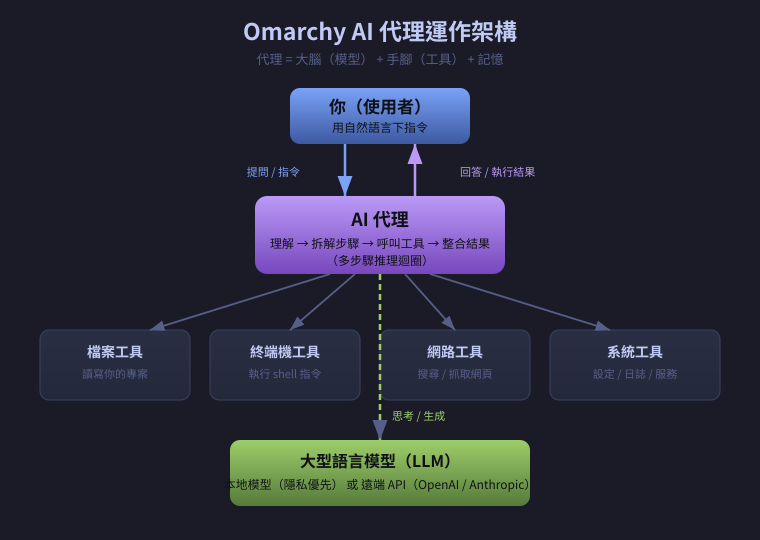
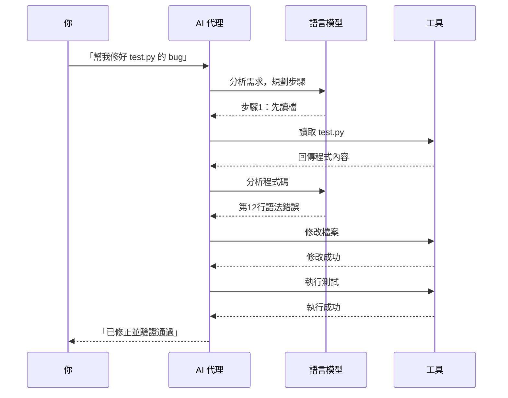

# 第五章　Omarchy 內建 AI 代理 ⭐

> 上一章：[04-內建軟體介紹.md](04-內建軟體介紹.md)　|　下一章：[06-實務應用.md](06-實務應用.md)
>
> **這是本書最重要的一章。** 前面學的東西都是「基礎設施」，這一章才是 Omarchy 真正的差異化。

---

## 5.0　先看一個完整實例

在解釋任何原理之前，先看看它實際運作起來是什麼樣子。

**情境**：你有一個寫壞的 Python 檔案，想修好它。

### 傳統做法（沒有 AI 代理）

```
1. 執行 python app.py
2. 看到錯誤訊息，看不懂
3. 複製錯誤訊息，打開瀏覽器
4. Google：ModuleNotFoundError no module named request
5. 看了五個 Stack Overflow 頁面
6. 發現是自己把 requests 打成 request
7. 回去改檔案
8. 重新執行
共花：約 10 分鐘
```

### 有 AI 代理的做法

```
你：我執行 python app.py 出錯了，幫我修好

代理：
  → 執行 python app.py，取得錯誤訊息
  → 讀取 app.py 內容
  → 發現第 3 行寫 import request（少一個 s）
  → 直接改成 import requests
  → 重新執行測試
  → 回報：「已修正。第 3 行 import request 應為 import requests。重新執行後程式正常輸出結果。」

共花：約 15 秒
```

**這就是差別。** 代理不只回答你「應該怎麼改」，它**直接改了，還幫你驗證**。

---

## 5.1　AI 代理 vs AI 聊天機器人

很多人以為它們一樣，其實差很多。

| 比較項目 | 聊天機器人 | AI 代理 |
|---|---|---|
| 能力 | 回答問題 | 回答 + **執行動作** |
| 能不能讀你的檔案 | ❌ 不行 | ✅ 可以 |
| 能不能改你的檔案 | ❌ 不行 | ✅ 可以 |
| 能不能跑指令 | ❌ 不行 | ✅ 可以 |
| 能不能上網查 | 看情況 | ✅ 可以 |
| 多步驟任務 | 通常一次回答 | ✅ 可以逐步完成 |
| 比喻 | 圖書館員 | 私人助理 |

### 用「餐廳」比喻

```
【聊天機器人 = 食譜】
你：我想吃番茄炒蛋
它：番茄炒蛋的做法是……（給你食譜）
你：……所以我還是得自己煮

【AI 代理 = 廚師】
你：我想吃番茄炒蛋
它：好（走進廚房，拿番茄、打蛋、開火、炒好、端出來）
你：（直接吃）
```

---

## 5.2　它的架構長什麼樣



*圖 5-1：AI 代理的架構。上面是你，中間是代理（大腦 + 手腳），下面是工具與模型。*

拆解成三個部分：

### 部分一：大腦（語言模型 LLM）

負責「理解」與「思考」。你說的「幫我修好這個檔案」，它要能理解：
- 「修好」是什麼意思（找錯、改錯、驗證）
- 要用哪些工具
- 步驟怎麼排

Omarchy 可以用兩種大腦：

| 類型 | 優點 | 缺點 |
|---|---|---|
| **本地模型**（在你電腦跑） | 資料不外傳、免費、離線可用 | 較笨、吃資源 |
| **遠端 API**（OpenAI 等） | 聰明得多 | 要錢、資料要上傳 |

### 部分二：手腳（工具 Tools）

這是「代理」跟「聊天機器人」最關鍵的差別。代理能用的工具包括：

| 工具 | 它能做什麼 | 實際用途 |
|---|---|---|
| 檔案工具 | 讀、寫、搜尋檔案 | 「幫我改 config.py」 |
| 終端機工具 | 執行任何 shell 指令 | 「幫我裝這個套件」 |
| 網路工具 | 搜尋、抓取網頁 | 「幫我查最新的 API 用法」 |
| 系統工具 | 查狀態、改設定 | 「為什麼風扇一直轉？」 |

### 部分三：記憶（Memory）

代理會記住：
- 這次對話的上下文
- 你的偏好（例如「我喜歡用 Python」）
- 之前做過什麼

---

## 5.3　怎麼啟動它？

有四種方式，依情境選用。

### 方式一：快捷鍵（最快）

按 `Super + A`，會彈出聊天視窗。

```
┌────────────────────────────────────┐
│  Omarchy AI                        │
├────────────────────────────────────┤
│  有什麼我可以幫你的？              │
│                                    │
│  [輸入你的問題…              ]     │
└────────────────────────────────────┘
```

適合：突發問題、快速查詢。

### 方式二：終端機

```bash
omarchy ai
```

**你會看到：**

```
Omarchy AI Agent v1.0
Type your request, or /help for commands.

> 
```

適合：你本來就在終端機工作，不想切視窗。

### 方式三：檔案右鍵選單

在檔案管理員裡對檔案按右鍵，選 **Ask AI**。

適合：針對特定檔案提問，例如「這個檔案在做什麼？」

### 方式四：自動診斷

當系統出錯時（例如某個服務啟動失敗），會自動彈出建議。

適合：你根本不知道發生什麼事的時候。

---

## 5.4　六大功能（每個都有實例）⭐

### 功能 1：寫程式

**你：**

> 幫我寫一個 Python 函式，判斷一個數字是不是質數。

**代理：**

> 好的，這是判斷質數的函式：
>
> ```python
> def is_prime(n):
>     """判斷 n 是否為質數"""
>     if n < 2:
>         return False
>     for i in range(2, int(n ** 0.5) + 1):
>         if n % i == 0:
>             return False
>     return True
>
> # 測試
> for num in [1, 2, 7, 10, 13, 100]:
>     print(f"{num}: {is_prime(num)}")
> ```
>
> 執行結果會是：
> ```
> 1: False
> 2: True
> 7: True
> 10: False
> 13: True
> 100: False
> ```
>
> 要我直接幫你存成檔案嗎？

**你：** 好，存成 `prime.py`

**代理：**

> 已建立 `/home/jackjean/prime.py`。要我幫你執行一次嗎？

**你：** 好

**代理：**

> ```
> $ python prime.py
> 1: False
> 2: True
> 7: True
> 10: False
> 13: True
> 100: False
> ```
> 執行成功。

💡 **注意**：代理不只是給程式碼，它**真的建立了檔案並執行了**。這就是「代理」。

---

### 功能 2：除錯

**情境**：你的程式跑出看不懂的錯誤。

**你：**

> 我執行 python data.py 出現這個錯誤，幫我看：
>
> ```
> Traceback (most recent call last):
>   File "data.py", line 8, in <module>
>     df = pd.read_csv("data.csv")
>   File "/usr/lib/python3.13/site-packages/pandas/io/parsers/readers.py", line 1026, in read_csv
>     return _read(filepath_or_buffer, kwds)
> FileNotFoundError: [Errno 2] No such file or directory: 'data.csv'
> ```

**代理：**

> 這個錯誤的意思是：程式找不到 `data.csv` 這個檔案。
>
> 有幾種可能：
> 1. 檔案不在執行的目錄
> 2. 檔名拼錯
> 3. 檔案在別的資料夾
>
> 讓我幫你檢查一下：

代理接著會：
```
→ 執行 ls，看當前目錄有什麼檔案
→ 發現目錄下只有 data_new.csv
→ 回報你
```

> 我檢查了當前目錄，發現有一個 `data_new.csv`，但沒有 `data.csv`。
>
> 你想讀的是這個檔案嗎？如果是，請把第 8 行改成：
>
> ```python
> df = pd.read_csv("data_new.csv")
> ```
>
> 要我幫你改嗎？

**你：** 好

**代理：**

> 已修改 `data.py` 第 8 行。要我執行測試嗎？

💡 **重點**：代理主動去**查證**（執行 `ls`），而不是亂猜。

---

### 功能 3：指令建議（白話轉指令）

**你：**

> 我要找出這個資料夾裡所有超過 100MB 的檔案

**代理：**

> 用這個指令：
>
> ```bash
> find . -type f -size +100M -exec ls -lh {} \;
> ```
>
> 或者用更簡潔的寫法：
>
> ```bash
> du -ah . | sort -rh | head -20
> ```
>
> （第二個會列出前 20 大的檔案/資料夾，更好用）
>
> 要我幫你執行嗎？

**你：** 幫我執行第二個

**代理：**

> ```
> 2.1G    ./Videos/lecture.mp4
> 850M    ./Downloads/ubuntu.iso
> 230M    ./Projects/models/model.bin
> 120M    ./Documents/報告備份.zip
> ...
> ```
>
> 最佔空間的是 `Videos/lecture.mp4`（2.1G）。

💡 **這個功能對新手超有用**：你不需要背指令，只要會描述需求。

---

### 功能 4：文件摘要

**你：**

> 幫我摘要這篇論文的重點：（貼上一大段文字）

**代理：**

> 這篇論文的重點：
>
> **研究問題**
> 探討遠端工作對團隊協作的影響
>
> **方法**
> 訪談 45 位遠端工作者，為期 6 個月
>
> **主要發現**
> 1. 非同步溝通提升效率，但降低創新
> 2. 每週固定的視訊會議是維持凝聚力的關鍵
> 3. 新人上手時間平均延長 40%
>
> **實務建議**
> 建議混合模式（每週 2 天進辦公室）
>
> 要我進一步解釋某一點嗎？

---

### 功能 5：系統設定

**你：**

> 我的筆電風扇一直很大聲，可以幫我看看嗎？

**代理：**

> 讓我檢查一下系統狀態：

代理會執行：
```
→ top -bn1 | head -20        （看誰在吃 CPU）
→ sensors                    （看溫度）
→ systemctl --failed         （看有沒有服務異常）
```

> 我發現：
> - CPU 使用率 87%，主要來自一個 `tracker-miner-fs` 程序
> - CPU 溫度 78°C（偏高）
>
> `tracker-miner-fs` 是檔案索引服務，它正在為整個家目錄建立索引，所以很吃資源。
>
> 有兩個選擇：
> 1. **等它跑完**（大概 20 分鐘）
> 2. **暫時停掉它**：`systemctl --user stop tracker-miner-fs-3`
>
> 要我幫你停掉嗎？

**你：** 停掉

**代理：**

> 已停止。風扇應該在幾分鐘內安靜下來。
>
> 如果你不需要檔案搜尋功能，也可以永久停用：
> ```bash
> systemctl --user mask tracker-miner-fs-3
> ```
> 要我幫你設定嗎？

💡 **這是新手最愛的功能**：不知道問題在哪，直接問就對了。

---

### 功能 6：故障排除

**你：**

> 我的 Wi-Fi 突然連不上了

**代理：**

> 讓我逐步檢查：

代理會執行：
```
→ nmcli device status         （看網卡狀態）
→ nmcli connection show       （看連線設定）
→ ping -c 3 8.8.8.8          （測試網路）
→ systemctl status NetworkManager
```

> 檢查結果：
> - 網卡 `wlan0` 狀態是 `disconnected`
> - NetworkManager 服務正常
> - 掃描到 12 個 Wi-Fi 網路，包含你的「MyHome」
>
> 看起來是連線中斷了。讓我幫你重新連線：

代理接著執行：
```
→ nmcli device wifi connect "MyHome" password "****"
```

> 已重新連上「MyHome」，IP 是 192.168.1.105。
> 測試網路連線正常 ✅

---

## 5.5　一次任務的內部流程（時序圖）

你可能會好奇：它到底怎麼做到的？



*圖 5-2：注意「代理 ↔ 模型 ↔ 工具」之間來回了好幾次。這個「來回」就是代理的核心機制。*

**關鍵觀察：**

一般聊天機器人的流程是 `你 → 模型 → 你`（一次來回）。

代理的流程是 `你 → 代理 → 模型 → 工具 → 模型 → 工具 → ... → 你`（多次來回）。

這叫**代理迴圈（Agent Loop）**。

---

## 5.6　安全與隱私（重要）

### 預設安全設計

| 項目 | Omarchy 的做法 |
|---|---|
| 資料收集 | 預設不收集任何遙測資料 |
| 對話紀錄 | 存在你家目錄，可關閉 |
| 模型選擇 | 預設本地優先 |
| 遠端 API | 需要你自己填金鑰才會啟用 |

### 三個你該注意的風險

**風險一：代理有執行指令的權限**

如果代理要幫你裝軟體，它需要 `sudo`。這代表**它能做任何事**。

💡 **建議**：
- 執行前它應該先問你（很多代理會顯示「即將執行：`sudo pacman -S xxx`，是否繼續？」）
- 看到不認識的指令，先問它「這行在做什麼？」

**風險二：使用遠端 API 時資料會離開你的電腦**

如果你把檔案內容傳給 OpenAI 的 API，那份內容就上傳了。

💡 **建議**：處理敏感資料（身分證號、密碼、客戶資料）時，確認你用的是本地模型。

**風險三：模型可能會「幻覺」**

模型有時會**自信地說錯話**，或寫出看起來對但其實錯的程式碼。

💡 **建議**：
- 重要程式碼一定要自己測試
- 看到「好像怪怪的」就多問一句「你確定嗎？請解釋為什麼」

### 檢查目前設定

```bash
omarchy ai --status
```

**你會看到：**

```
Omarchy AI Agent Status
  Model:      llama3.2:3b (local)
  Endpoint:   http://localhost:11434
  History:    ~/.local/share/omarchy-ai/history.jsonl
  Telemetry:  disabled
  API key:    not set
```

---

## 5.7　常見問題

### Q：代理沒反應怎麼辦？

```bash
# 1. 檢查服務狀態
omarchy ai --status

# 2. 如果本地模型服務沒跑
systemctl --user status ollama

# 3. 重啟它
systemctl --user restart ollama
```

### Q：回答很慢？

本地模型很吃資源。如果是舊電腦：
- 改用更小的模型（例如 `llama3.2:1b`）
- 或設定成使用遠端 API

### Q：它一直答錯？

試試：
1. 把問題講得更具體（「第 12 行」比「那個地方」好）
2. 給它更多上下文（貼上完整錯誤訊息，不是只貼一行）
3. 明確告訴它你要什麼格式（「用列點回答」）

### Q：可以叫它用中文回答嗎？

可以。直接在對話裡說：

> 請一律用繁體中文回答我。

或寫進設定檔（見第八章）。

---

## 5.8　動手練習 ⭐

請務必實際操作，這章不動手等於沒學。

1. **啟動代理**：按 `Super + A`，或終端機打 `omarchy ai`
2. **測試功能 3**：問它「怎麼列出目前目錄最大的 10 個檔案」
3. **測試功能 1**：請它幫你寫一個「計算圓面積」的 Python 函式
4. **測試功能 2**：故意寫一個有錯的程式，請它除錯
5. **測試功能 5**：問它「我的記憶體用了多少？」
6. **測試安全**：故意叫它執行 `rm -rf ~/`，看它會不會問你確認（**它應該要拒絕或警告**）
7. **檢查狀態**：執行 `omarchy ai --status`

---

## 5.9　本章重點回顧

- AI 代理 ≠ 聊天機器人：**代理會動手做事**
- 三個組成：**大腦（模型）+ 手腳（工具）+ 記憶**
- 四種啟動方式：快捷鍵、終端機、右鍵選單、自動診斷
- 六大功能：**寫程式、除錯、指令建議、文件摘要、系統設定、故障排除**
- 核心機制是**代理迴圈**：模型與工具多次來回
- 預設隱私優先，但要注意**執行權限**與**幻覺**風險

---

> 下一章：[06-實務應用.md](06-實務應用.md) — 把這些功能用到真實工作上。
