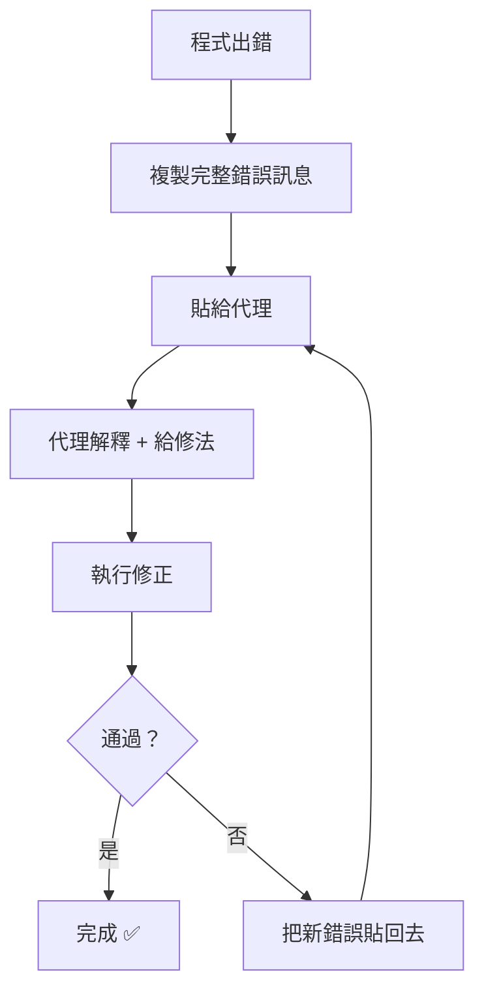
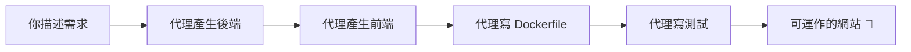

# 第六章　實務應用：用 AI 代理工作

> 上一章：[05-內建AI代理.md](05-內建AI代理.md)　|　下一章：[07-系統管理與維護.md](07-系統管理與維護.md)

---

## 6.0　本章要解決的問題

第五章教你「代理能做什麼」。這一章教你「**怎麼把它用得順**」。

核心觀念：

> **好的提問方式，決定代理的產出品質。**

同樣一個任務，講得越清楚，代理做得越對。本章會用大量「**爛提問 vs 好提問**」的對照幫你抓到訣竅。

---

## 6.1　提問的藝術：三個原則

### 原則一：給上下文

```
❌ 爛提問：
「我的程式壞了」

✅ 好提問：
「我的 Python 程式 /home/jackjean/app.py 執行時
 出現 ModuleNotFoundError: No module named 'pandas'
 請幫我修好」
```

**差別**：好提問給了**檔案路徑**與**完整錯誤訊息**，代理不用猜。

### 原則二：說清楚你要什麼

```
❌ 爛提問：
「幫我處理一下這個資料」

✅ 好提問：
「幫我寫一個 Python 腳本，讀取 sales.csv，
 計算每個月的總銷售額，輸出成一個新的 CSV 檔，
 欄位要有 month 和 total」
```

**差別**：好提問明確了**輸入、輸出、格式**。

### 原則三：要求它驗證

```
❌ 爛提問：
「幫我寫一個排序函式」

✅ 好提問：
「幫我寫一個排序函式，並寫三個測試案例驗證它正確」
```

**差別**：加上「驗證」，代理會自己跑測試確認沒問題。

### 提問公式（可以背下來）

```
【任務】請幫我做 ______
【輸入】檔案是 ______，內容大概是 ______
【輸出】我要的結果是 ______，格式是 ______
【限制】不能動到 ______，要用 ______
【驗證】完成後請 ______ 驗證
```

---

## 6.2　實例：從零寫一個小工具

**目標**：寫一個「把資料夾裡所有圖片縮小」的腳本。

### 第 1 步：描述需求

> **你：** 請幫我寫一個 Python 腳本，功能是把指定資料夾裡所有 .jpg 和 .png 圖片縮小到寬度不超過 800 像素，輸出到另一個資料夾。請保留原始檔名，並在完成後印出處理了幾張。

> **代理：**
> ```python
> #!/usr/bin/env python3
> """批次縮圖工具"""
> import sys
> from pathlib import Path
> from PIL import Image
>
> def resize_images(src_dir, dst_dir, max_width=800):
>     src = Path(src_dir)
>     dst = Path(dst_dir)
>     dst.mkdir(parents=True, exist_ok=True)
>
>     count = 0
>     for f in src.iterdir():
>         if f.suffix.lower() not in ('.jpg', '.jpeg', '.png'):
>             continue
>         img = Image.open(f)
>         if img.width > max_width:
>             ratio = max_width / img.width
>             new_size = (max_width, int(img.height * ratio))
>             img = img.resize(new_size, Image.LANCZOS)
>         img.save(dst / f.name)
>         count += 1
>     print(f"完成，共處理 {count} 張圖片")
>
> if __name__ == "__main__":
>     resize_images(sys.argv[1], sys.argv[2])
> ```
> 需要 `Pillow` 套件。要我幫你安裝並測試嗎？

### 第 2 步：讓它執行

> **你：** 好

> **代理：**
> ```
> → 執行：pip install Pillow
> → 建立測試資料夾與假圖片
> → 執行：python resize.py test_in test_out
> 輸出：完成，共處理 3 張圖片
> → 驗證輸出圖片的寬度都 ≤ 800 ✅
> ```
> 已完成並測試通過。腳本在 `/home/jackjean/resize.py`。

### 第 3 步：加功能

> **你：** 再加一個功能：如果圖片本來就小於 800 寬，就直接複製，不要重新編碼（避免損失畫質）

> **代理：** 已修改。現在會先判斷寬度，小於等於 800 的直接用 `shutil.copy2` 複製。已重新測試 ✅

💡 **重點**：整個過程你只說了三句話，得到一個測試過的可運作腳本。

---

## 6.3　實例：程式碼審查

**情境**：你寫完一段程式，想確認有沒有問題。

> **你：** 幫我審查這段程式，指出問題：
> ```python
> def get_user(id):
>     conn = sqlite3.connect('db.sqlite')
>     cursor = conn.cursor()
>     cursor.execute(f"SELECT * FROM users WHERE id = {id}")
>     return cursor.fetchone()
> ```

> **代理：** 這段程式有 **三個嚴重問題**：
>
> **🔴 問題 1：SQL 注入漏洞（最嚴重）**
> 用 f-string 拼接 SQL，如果 `id` 是 `1 OR 1=1`，會查到所有使用者。
>
> 修正：
> ```python
> cursor.execute("SELECT * FROM users WHERE id = ?", (id,))
> ```
>
> **🟠 問題 2：連線沒有關閉**
> `conn` 開著沒關，長時間執行會耗盡連線。
>
> 修正：用 `with` 語句
> ```python
> with sqlite3.connect('db.sqlite') as conn:
>     ...
> ```
>
> **🟡 問題 3：`id` 是保留字**
> Python 內建 `id()` 函式，變數取名 `id` 會遮蔽它。建議改成 `user_id`。
>
> **修正後的完整版本：**
> ```python
> def get_user(user_id):
>     with sqlite3.connect('db.sqlite') as conn:
>         cursor = conn.cursor()
>         cursor.execute("SELECT * FROM users WHERE id = ?", (user_id,))
>         return cursor.fetchone()
> ```
> 要我幫你直接改檔案嗎？

💡 **學習價值**：代理不只是「修好」，還**解釋為什麼**，這對學習很有幫助。

---

## 6.4　實例：除錯迴圈



*圖 6-1：除錯是一個循環——錯了就再貼回去，直到通過。*

**實際的一輪對話：**

> **你：** 執行 `npm run dev` 出現：
> ```
> Error: Cannot find module 'vite'
> Require stack:
> - /home/jackjean/proj/node_modules/.bin/vite
> ```

> **代理：** 這表示 `vite` 沒安裝，或 `node_modules` 不完整。
>
> 讓我檢查：
> ```
> → cat package.json | grep vite
> → ls node_modules | grep vite
> ```
>
> 檢查結果：
> - `package.json` 裡有 `vite` 在 devDependencies
> - 但 `node_modules` 裡沒有
>
> 可能是之前安裝中斷。請執行：
> ```bash
> rm -rf node_modules package-lock.json
> npm install
> ```
> 要我幫你執行嗎？

> **你：** 好

> **代理：**
> ```
> → 執行 rm -rf node_modules package-lock.json
> → 執行 npm install
> added 245 packages in 18s
> → 執行 npm run dev
> VITE v5.0.0  ready in 320 ms
> ➜  Local:   http://localhost:5173/
> ```
> 修好了！開發伺服器已啟動在 http://localhost:5173/

---

## 6.5　實例：重構

**情境**：一個函式太長，想拆開。

> **你：** 這個函式有 80 行，做太多事了，幫我重構：
> （貼上程式碼）

> **代理：** 我分析了這個函式，它做了 **4 件事**，建議拆成 4 個小函式：
>
> | 原區塊 | 行數 | 提議的新函式 |
> |---|---|---|
> | 驗證輸入 | 1-15 | `validate_input()` |
> | 查資料庫 | 16-35 | `fetch_data()` |
> | 計算統計 | 36-60 | `compute_stats()` |
> | 產生報表 | 61-80 | `generate_report()` |
>
> **重構後的樣子：**
> ```python
> def process_report(raw):
>     data = validate_input(raw)
>     records = fetch_data(data)
>     stats = compute_stats(records)
>     return generate_report(stats)
> ```
>
> 主函式從 80 行變成 5 行，每個子函式都能單獨測試。
>
> 要我：
> (A) 直接改檔案
> (B) 先產生 diff 讓你確認
> (C) 只給我新程式碼，我自己貼

💡 **好習慣**：重構時選 **(B) 先看 diff**，確認沒問題再套用。

---

## 6.6　實例：Git 工作流整合

### 自動寫 commit 訊息

> **你：** 幫我看這次改了什麼，寫一個 commit 訊息

> **代理：**
> ```
> → git diff --stat
> ```
> 你改了：
> - `src/auth.py`：新增 JWT 驗證
> - `src/routes.py`：加入 /login 端點
> - `tests/test_auth.py`：新增 5 個測試
>
> 建議的 commit 訊息：
> ```
> feat: 新增 JWT 登入驗證
>
> - 實作 token 產生與驗證
> - 新增 /login 與 /logout 端點
> - 補上 5 個單元測試
> ```
> 要我幫你執行 commit 嗎？

### 解決 Git 衝突

> **你：** 我 merge 的時候有衝突，幫我看
> ```
> CONFLICT (content): Merge conflict in src/config.py
> ```

> **代理：**
> ```
> → cat src/config.py（看衝突區塊）
> ```
> ```
> <<<<<<< HEAD
> DEBUG = False
> API_URL = "https://api.prod.com"
> =======
> DEBUG = True
> API_URL = "https://api.staging.com"
> >>>>>>> feature-branch
> ```
> 看起來你（main 分支）用的是正式環境設定，feature 分支用的是測試環境。
>
> 建議：
> - 如果這是**要合併到正式** → 保留上面（HEAD）
> - 如果這是**還在測試階段** → 保留下面
>
> 你想保留哪個？

---

## 6.7　完整案例：從零做一個待辦事項網站

這是本章的綜合演練。假設你完全不會寫網頁。

### 步驟 1：規劃

> **你：** 我想做一個簡單的待辦事項網站，可以新增、勾選完成、刪除。用什麼技術好？

> **代理：** 對初學者，我建議：
>
> - **前端**：原生 HTML + JavaScript（不用學框架，最快看到成果）
> - **後端**：Python FastAPI（簡單、好懂）
> - **資料庫**：SQLite（不用架設，一個檔案就是資料庫）
>
> 整個專案大概 5 個檔案。要我開始建嗎？

### 步驟 2：產生後端

> **你：** 好，先做後端

> **代理：** 建立了 `backend/main.py`：
> ```python
> from fastapi import FastAPI
> from pydantic import BaseModel
> import sqlite3
>
> app = FastAPI()
>
> def init_db():
>     conn = sqlite3.connect('todos.db')
>     conn.execute('''CREATE TABLE IF NOT EXISTS todos
>                     (id INTEGER PRIMARY KEY, text TEXT, done INTEGER DEFAULT 0)''')
>     conn.commit()
>     conn.close()
>
> init_db()
>
> class Todo(BaseModel):
>     text: str
>
> @app.get("/todos")
> def list_todos():
>     conn = sqlite3.connect('todos.db')
>     rows = conn.execute("SELECT id, text, done FROM todos").fetchall()
>     conn.close()
>     return [{"id": r[0], "text": r[1], "done": bool(r[2])} for r in rows]
>
> @app.post("/todos")
> def add_todo(todo: Todo):
>     conn = sqlite3.connect('todos.db')
>     cur = conn.execute("INSERT INTO todos (text) VALUES (?)", (todo.text,))
>     conn.commit()
>     new_id = cur.lastrowid
>     conn.close()
>     return {"id": new_id, "text": todo.text, "done": False}
>
> @app.delete("/todos/{todo_id}")
> def delete_todo(todo_id: int):
>     conn = sqlite3.connect('todos.db')
>     conn.execute("DELETE FROM todos WHERE id = ?", (todo_id,))
>     conn.commit()
>     conn.close()
>     return {"ok": True}
> ```
> 要我裝 FastAPI 並測試嗎？

### 步驟 3：產生前端

> **你：** 好，也幫我做前端

> **代理：** 建立了 `frontend/index.html`（含 HTML、CSS、JS）。
> 功能包含：輸入框新增、清單顯示、勾選、刪除按鈕。

### 步驟 4：啟動並測試

> **代理：**
> ```
> → pip install fastapi uvicorn
> → 啟動後端：uvicorn main:app --reload
> → 測試 API：
>    POST /todos {"text":"買牛奶"}  → 201 OK
>    GET /todos                     → [{"id":1,"text":"買牛奶","done":false}]
>    DELETE /todos/1                → {"ok":true}
> → 所有端點測試通過 ✅
> ```
> 後端在 http://localhost:8000，前端打開 `frontend/index.html` 即可。

### 步驟 5：打包成 Docker

> **你：** 幫我寫 Dockerfile 和 docker-compose，讓別人也能一鍵跑起來

> **代理：** 已建立 `Dockerfile` 與 `docker-compose.yml`。
> 使用方式：
> ```bash
> docker compose up
> ```
> 然後打開 http://localhost:8000

### 步驟 6：寫測試

> **你：** 幫我寫測試

> **代理：** 建立了 `tests/test_api.py`，包含 6 個測試案例：
> - 新增待辦
> - 列出待辦
> - 刪除待辦
> - 空清單
> - 刪除不存在的項目
> - 新增空字串（邊界情況）
>
> 執行結果：`6 passed in 0.42s` ✅

### 成果



*圖 6-2：你只出了大約 6 句話，得到一個完整專案。*

**你總共打的字**：約 100 字。
**完成的專案**：前後端 + 資料庫 + Docker + 測試。

---

## 6.8　常見錯誤：不要在這些情況下用代理

代理很強，但不是萬能。

| 情況 | 為什麼不適合 | 該怎麼做 |
|---|---|---|
| 處理機密資料 + 用遠端 API | 資料會上傳 | 改用本地模型 |
| 需要 100% 正確的關鍵程式 | 有幻覺風險 | 自己寫，或寫完嚴格測試 |
| 你不懂它在做什麼 | 出事無法收拾 | 先要求它解釋每一步 |
| 破壞性操作（rm -rf） | 不可逆 | 一定要它先 `--dry-run` 或確認 |

### 實例：危險指令的處理

```
❌ 這樣問很危險：
「幫我清空 /tmp 裡所有東西」

✅ 這樣問才安全：
「幫我列出 /tmp 裡所有超過 7 天沒用的檔案，
 先給我看清單，不要刪除」
```

💡 **黃金規則**：**任何刪除或覆蓋的操作，先要它列出清單或 `--dry-run`。**

---

## 6.9　動手練習

1. 用「提問公式」請代理寫一個小工具（例如：批次重新命名檔案）
2. 拿一段自己的程式碼請代理審查
3. 故意製造一個錯誤，走一次完整的除錯迴圈
4. 請代理幫你寫一個 commit 訊息
5. 用代理的 Git 衝突解決功能（可以自己製造一個衝突來試）

---

## 6.10　本章重點回顧

- 提問三原則：**給上下文、說清楚要什麼、要求驗證**
- 提問公式：任務 / 輸入 / 輸出 / 限制 / 驗證
- 除錯是**循環**，錯了就再貼回去
- 重構時**先看 diff 再套用**
- 危險操作一定要 `--dry-run` 或先看清單

---

> 下一章：[07-系統管理與維護.md](07-系統管理與維護.md)
