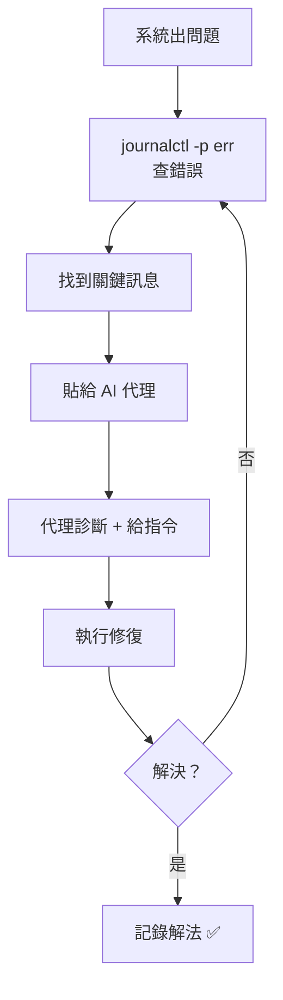

# 第七章　系統管理與維護

> 上一章：[06-實務應用.md](06-實務應用.md)　|　下一章：[08-進階客製化.md](08-進階客製化.md)

---

## 7.0　為什麼要學這章？

系統用久了總會遇到：
- 電腦變慢
- 硬碟滿了
- 某個服務壞了
- 更新出問題

這章教你**日常維護**，讓系統保持順暢。

---

## 7.1　更新的正確做法

### 多久更新一次？

Arch Linux 是**滾動更新**——不像 Ubuntu 每半年出一個大版本，它是持續更新的。

| 頻率 | 評價 |
|---|---|
| 每天 | 有點頻繁，但最安全 |
| **每週 1 次** | ✅ 建議 |
| 每月 1 次 | 可接受 |
| 半年 1 次 | ⚠️ 容易出問題 |

**為什麼放太久不好？**

Arch 的套件彼此有依賴關係。如果 A 套件更新了、要求新版 B，而你的 B 還很舊，就可能衝突。

### 標準更新流程

```bash
# 1. 先看有什麼更新
checkupdates
```

**你會看到：**

```
linux 6.12.1-1 -> 6.12.2-1
firefox 133.0-1 -> 133.0.1-1
python 3.13.0-1 -> 3.13.1-1
```

```bash
# 2. 執行更新
sudo pacman -Syu
```

**你會看到：**

```
:: Synchronizing package databases...
 core                    132.5 KiB   450 KiB/s
 extra                     8.2 MiB   2.1 MiB/s
:: Starting full system upgrade...
resolving dependencies...
looking for conflicting packages...

Packages (3) firefox-133.0.1-1  linux-6.12.2-1  python-3.13.1-1

Total Download Size:    210.45 MiB
Total Installed Size:   680.12 MiB

:: Proceed with installation? [Y/n]
```

### 💡 更新前的三個好習慣

```bash
# 習慣 1：先看 Arch 官網有沒有需要注意的公告
# https://archlinux.org/news/

# 習慣 2：重要工作前不要更新（避免更新後臨時出問題）

# 習慣 3：更新前先備份重要設定
cp -r ~/.config ~/.config.bak-$(date +%Y%m%d)
```

### 更新後出問題怎麼辦？

```bash
# 看 pacman 有沒有留下 .pacnew 檔案（新版本設定，需要手動合併）
sudo find /etc -name "*.pacnew"
```

**你會看到：**

```
/etc/pacman.conf.pacnew
/etc/ssh/sshd_config.pacnew
```

這代表官方更新了預設設定檔，但沒有覆蓋你的版本（怕蓋掉你的修改）。你需要手動比較：

```bash
# 比較差異
diff /etc/pacman.conf /etc/pacman.conf.pacnew
```

決定怎麼合併後，刪掉 `.pacnew`：

```bash
sudo rm /etc/pacman.conf.pacnew
```

💡 **也可以請 AI 代理幫你**：「幫我比較 /etc/pacman.conf 和 .pacnew，告訴我差在哪、該不該合併」。

---

## 7.2　效能監控

### 工具一：btop（看整體）

```bash
btop
```

```
┌─ CPU ─────────────────────────────────────────────┐
│ ▁▂▃▅▇█▇▅▃▂▁▂▃▅▇  23%  [8 cores] 45°C             │
├─ Mem ─────────────────────────────────────────────┤
│ ██████████░░░░░░░░░░  7.4G / 16G  (46%)           │
├─ Disk ────────────────────────────────────────────┤
│ ████████████████░░░░  412G / 512G  (80%)          │
├─ Net ─────────────────────────────────────────────┤
│ ↓ 2.1 MB/s   ↑ 450 KB/s                           │
└───────────────────────────────────────────────────┘
```

按 `q` 離開。

### 工具二：htop（看程序）

```bash
htop
```

會列出每一個程序，按 CPU 或記憶體排序，找出吃資源的元凶。

```
  PID USER      CPU%  MEM%  COMMAND
 4821 jackjean  45.2  12.3  firefox
 5102 jackjean  22.1   3.1  node
 1234 root       8.4   0.5  Xorg
```

按 `F6` 可以選擇排序依據，按 `F9` 可以殺掉程序，按 `q` 離開。

### 實例：找出為什麼電腦變慢

> **你：** 我的電腦突然變很慢，幫我查

> **代理：**
> ```
> → top -bn1 | head -15
> → free -h
> → df -h
> ```
> 診斷結果：
>
> | 項目 | 數值 | 判斷 |
> |---|---|---|
> | CPU | 92% | 🔴 異常 |
> | 記憶體 | 15.2G / 16G | 🔴 快滿了 |
> | 磁碟 | 80% | 🟡 偏高 |
>
> 主要元凶是 `firefox` 佔了 4.2G 記憶體（開了太多分頁），加上 `node` 佔 2.1G。
>
> 建議：
> 1. 關掉不用的 Firefox 分頁
> 2. 檢查有沒有忘記關的 `node` 開發伺服器
>
> 要我幫你列出所有 node 程序嗎？

---

## 7.3　磁碟空間管理

### 先看哪裡滿了

```bash
df -h
```

**你會看到：**

```
Filesystem      Size  Used Avail Use% Mounted on
/dev/nvme0n1p2  476G  412G   40G  92% /
tmpfs           7.8G  2.1M  7.8G   1% /tmp
```

### 找出大檔案

```bash
# 列出目前目錄前 20 大的項目
du -ah . | sort -rh | head -20
```

### 清理暫存

```bash
# 1. 清理 pacman 快取（舊版本的套件）
sudo pacman -Sc
```

**你會看到：**

```
Packages to keep:
  All locally installed packages

Cache directory: /var/cache/pacman/pkg/
:: Do you want to remove all other packages from cache? [Y/n]
```

這通常能清出好幾 GB。

```bash
# 2. 清理孤兒套件（沒人依賴的）
sudo pacman -Rns $(pacman -Qtdq)

# 3. 清理日誌（保留最近 7 天）
sudo journalctl --vacuum-time=7d
```

**你會看到：**

```
Deleted archived journal /var/log/journal/.../system@....journal (8.0M)
Vacuuming done, freed 245.0M of archived journals from /var/log/journal.
```

### 實例：請代理規劃清理

> **你：** 幫我看看哪裡佔空間，規劃怎麼清

> **代理：**
> ```
> → df -h
> → du -sh ~/* | sort -rh | head -10
> → du -sh ~/.cache ~/.local/share
> → du -sh /var/cache/pacman/pkg
> ```
>
> 分析結果：
>
> | 位置 | 大小 | 建議 |
> |---|---|---|
> | ~/.cache | 12.4G | 可清（會自動重建） |
> | /var/cache/pacman/pkg | 8.1G | 可清（保留最新版） |
> | ~/Downloads | 6.2G | 你自己決定 |
> | ~/.local/share/Trash | 3.1G | 可清（垃圾桶） |
>
> **建議清理順序：**
> ```bash
> # 1. 清垃圾桶（3.1G）
> rm -rf ~/.local/share/Trash/*
>
> # 2. 清 pacman 快取（8.1G）
> sudo pacman -Sc
>
> # 3. 清快取（12.4G，但某些程式首次啟動會變慢）
> rm -rf ~/.cache/*
> ```
> 總共可釋放約 **23.6G**。
>
> ⚠️ 要我先幫你執行第 1 和第 2 項嗎？（比較安全）

---

## 7.4　備份與快照

### 方法一：rsync（簡單可靠）

```bash
# 備份家目錄到外接硬碟
rsync -av --progress ~/Documents/ /media/backup/Documents/
```

**建議寫成腳本**，放在 `~/bin/backup.sh`：

```bash
#!/bin/bash
# 每日備份腳本
SRC="$HOME/Documents"
DST="/media/backup/Documents"
LOG="$HOME/backup.log"

echo "=== 備份開始 $(date) ===" >> "$LOG"
rsync -av --delete "$SRC/" "$DST/" >> "$LOG" 2>&1
echo "=== 備份結束 $(date) ===" >> "$LOG"
```

加上執行權限：

```bash
chmod +x ~/bin/backup.sh
```

### 方法二：Timeshift（系統快照）

如果你用 Btrfs 檔案系統（Omarchy 預設可能使用），可以做**系統快照**。

**快照 vs 備份的差別：**

| | 快照 | 備份 |
|---|---|---|
| 存哪裡 | 同一顆硬碟 | 另一顆硬碟/雲端 |
| 速度 | 秒級 | 分鐘級 |
| 硬碟壞了 | ❌ 一起消失 | ✅ 還在 |
| 用途 | 系統更新前保命 | 真正防災 |

💡 **兩個都要做**：快照防「手殘」，備份防「硬碟壞」。

### 實例：請代理規劃備份策略

> **你：** 我想要一個備份方案，我的資料有：程式專案（20G）、照片（50G）、文件（5G）

> **代理：** 建議這樣規劃：
>
> | 資料 | 頻率 | 方式 | 目的地 |
> |---|---|---|---|
> | 程式專案 | 每天 | Git push + rsync | GitHub + 外接硬碟 |
> | 照片 | 每週 | rsync | 外接硬碟 + 雲端 |
> | 文件 | 每天 | rsync | 外接硬碟 |
>
> 我可以幫你寫三個腳本，並設定成 systemd timer 自動執行。要我開始嗎？

---

## 7.5　故障排除：讀日誌

### journalctl 是什麼？

它是 systemd 的日誌系統，記錄系統發生的一切。

```bash
# 看最近的錯誤
journalctl -p err -n 50
```

**你會看到：**

```
Oct 19 14:32:01 omarchy systemd[1]: Failed to start Bluetooth service.
Oct 19 14:35:12 omarchy kernel: nvme0n1: I/O error, dev nvme0n1, sector 12345
```

### 常用參數

| 指令 | 功能 |
|---|---|
| `journalctl -b` | 只看這次開機 |
| `journalctl -b -1` | 看上次開機（除錯好用） |
| `journalctl -u 服務名` | 看特定服務 |
| `journalctl -f` | 即時追蹤（像 tail -f） |
| `journalctl -p err` | 只看錯誤等級 |

### 實例：藍牙壞了

> **你：** 我的藍牙連不上，幫我查

> **代理：**
> ```
> → systemctl status bluetooth
> → journalctl -u bluetooth -n 30
> → rfkill list
> ```
>
> 診斷結果：
>
> | 檢查 | 結果 | 判斷 |
> |---|---|---|
> | bluetooth.service | failed | 🔴 服務沒跑起來 |
> | journalctl | "Failed to set mode: Blocked through rfkill" | 🔴 被 rfkill 封鎖 |
> | rfkill list | Soft blocked: yes | 🔴 軟封鎖中 |
>
> **原因**：藍牙被軟體封鎖了（可能是誤按功能鍵）。
>
> **解法**：
> ```bash
> rfkill unblock bluetooth
> sudo systemctl restart bluetooth
> ```
> 要我幫你執行嗎？

> **你：** 好

> **代理：**
> ```
> → rfkill unblock bluetooth
> → systemctl restart bluetooth
> → systemctl is-active bluetooth
> active
> ```
> 藍牙服務已恢復正常，現在應該可以搜尋裝置了 ✅



*圖 7-1：系統除錯流程。*

---

## 7.6　安全維護

### 定期檢查

```bash
# 1. 看有哪些服務在跑
systemctl list-units --type=service --state=running

# 2. 看開放的通訊埠
ss -tulpn

# 3. 看使用者登入紀錄
last

# 4. 檢查 sudo 紀錄
journalctl -u sudo
```

### 用 AI 代理做安全檢查

> **你：** 幫我做一次基本的安全檢查

> **代理：**
> ```
> → ss -tulpn | grep LISTEN
> → systemctl list-units --type=service --state=running
> → cat /etc/ssh/sshd_config | grep -E "PermitRoot|PasswordAuth"
> → last | head -10
> → find / -perm -4000 -type f 2>/dev/null
> ```
>
> **檢查報告：**
>
> | 項目 | 結果 | 評價 |
> |---|---|---|
> | SSH 允許密碼登入 | 是 | ⚠️ 建議改成只用金鑰 |
> | SSH 允許 root 登入 | 否 | ✅ |
> | 未預期的開放埠 | 無 | ✅ |
> | SUID 檔案 | 12 個，都是標準的 | ✅ |
> | 最近登入 | 都是你自己 | ✅ |
>
> **建議修改 SSH 設定：**
> ```bash
> sudo nvim /etc/ssh/sshd_config
> # 改成：PasswordAuthentication no
> sudo systemctl restart sshd
> ```
> ⚠️ 改之前請確認你已經設定好 SSH 金鑰，否則會鎖死自己。

---

## 7.7　常見問題排解

### 問題：pacman 說「資料庫已鎖定」

```
error: failed to init transaction (unable to lock database)
```

**原因**：上次 pacman 沒正常結束，留下鎖定檔。

**解法**：

```bash
# 先確認沒有 pacman 在跑
ps aux | grep pacman

# 沒有的话，刪掉鎖定檔
sudo rm /var/lib/pacman/db.lck
```

### 問題：更新後某個程式打不開

**解法**：可能是依賴損壞。

```bash
# 重新安裝該程式
sudo pacman -S 程式名
```

或請代理看：

> 「firefox 更新後打不開，執行時出現 XXX 錯誤」

### 問題：硬碟快滿了但找不到大檔案

```bash
# 找出所有掛載點的使用量
df -h

# 從根目錄逐層往下找
sudo du -xh --max-depth=1 / | sort -rh | head -10
```

---

## 7.8　動手練習

1. 執行 `checkupdates` 看有什麼更新
2. 執行 `sudo pacman -Syu` 更新（如果有的話）
3. 打開 `btop`，看自己的資源使用情況
4. 執行 `df -h` 看磁碟使用率
5. 執行 `sudo pacman -Sc` 清理快取
6. 執行 `journalctl -p err -n 20` 看最近錯誤
7. 請 AI 代理做一次系統健康檢查

---

## 7.9　本章重點回顧

- **更新**：每週一次，`sudo pacman -Syu`，注意 `.pacnew` 檔案
- **監控**：`btop`（整體）、`htop`（程序）
- **清理**：`pacman -Sc`、清孤兒套件、清日誌
- **備份**：rsync（防災）+ Timeshift（防手殘），兩者都要
- **除錯**：`journalctl` 讀日誌，交給 AI 代理分析
- **安全**：定期檢查服務、埠、登入紀錄

---

> 下一章：[08-進階客製化.md](08-進階客製化.md)
