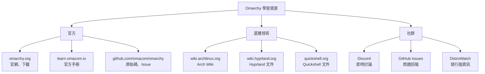
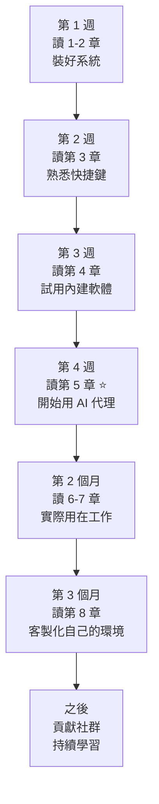

# 第九章　學習資源與附錄

> 上一章：[08-進階客製化.md](08-進階客製化.md)

---

## 9.1　官方資源（最權威）



*圖 9-1：學習資源地圖。*

| 資源 | 網址 | 用途 |
|---|---|---|
| 官方網站 | <https://omarchy.org/> | 下載、公告、最新版本 |
| 官方手冊 | <https://learn.omacom.io/2/the-omarchy-manual> | 最權威的說明 |
| GitHub | <https://github.com/omacom/omarchy> | 原始碼、issue、貢獻 |
| **Arch Wiki** | <https://wiki.archlinux.org/> | Linux 知識的百科全書 |
| Hyprland 文件 | <https://wiki.hyprland.org/> | 視窗管理設定 |
| Quickshell 文件 | <https://quickshell.org/> | 桌面外殼與插件 |

💡 **Arch Wiki 的重要性**：它是 Linux 界最詳盡的文件。你遇到的 90% 問題，Google 加上 `site:wiki.archlinux.org` 都能找到答案。

---

## 9.2　怎麼查問題（實用技巧）

### 技巧一：用 AI 代理先查

```
你：我執行 pacman 時出現 "database is locked"，怎麼解？
```

代理通常幾秒就給你答案，比 Google 快。

### 技巧二：Google 加上 site 限定

```
pacman database is locked site:wiki.archlinux.org
```

### 技巧三：看錯誤訊息裡的關鍵字

```
error: failed to commit transaction (conflicting files)
       ↑ 把這段拿去搜尋
```

### 技巧四：查日誌

```bash
journalctl -p err -n 50          # 系統錯誤
journalctl --user -p err -n 50   # 使用者層級錯誤
```

---

## 9.3　常見問題（FAQ）

### 安裝類

**Q：安裝後黑畫面 / 停在登入前？**

A：多半是顯示卡驅動問題。在開機選單按 `e`，在 `linux` 行結尾加 `nomodeset`，`Ctrl+X` 開機。

**Q：可以用在 Apple M1/M2/M3 上嗎？**

A：不行。Omarchy 是 x86_64 架構。Apple Silicon 需要 Asahi Linux 這類專案。

**Q：可以雙系統嗎？**

A：可以。但 Windows 要先關 BitLocker。

### 使用類

**Q：忘記 Super 鍵是哪個？**

A：就是鍵盤左下角的 Windows 標誌鍵（四個方格）。

**Q：快捷鍵都沒反應？**

A：先確認你按的是 Super（不是 Ctrl/Alt），然後 `hyprctl reload` 看有沒有錯誤。

**Q：視窗關不掉？**

A：`hyprctl kill` 然後點一下那個視窗。

### AI 代理類

**Q：代理沒反應？**

```bash
omarchy ai --status
systemctl --user restart ollama
```

**Q：回答很慢？**

本地模型吃資源。試試更小的模型，或切換到遠端 API。

**Q：可以只用本地模型嗎？**

可以。預設就是本地優先，不要填 API 金鑰即可。

**Q：對話紀錄存在哪？**

```bash
~/.local/share/omarchy-ai/history.jsonl
```

可以直接刪除，或設定關閉記錄。

### 系統類

**Q：更新後程式壞了？**

```bash
sudo pacman -S 程式名        # 重裝
# 或降級
sudo pacman -U /var/cache/pacman/pkg/程式名-舊版本.pkg.tar.zst
```

**Q：硬碟滿了？**

見第七章 7.3，通常是 pacman 快取和 `~/.cache`。

**Q：怎麼知道自己裝了什麼？**

```bash
pacman -Qe          # 明確安裝的套件
pacman -Q | wc -l   # 總數
```

---

## 9.4　指令速查表

### 系統 / 套件（pacman）

```bash
sudo pacman -Syu                  # 更新系統
sudo pacman -S 套件名              # 安裝
sudo pacman -Rns 套件名            # 移除（含相依）
pacman -Ss 關鍵字                  # 搜尋
pacman -Qs 關鍵字                  # 搜尋已安裝
checkupdates                      # 看有哪些更新
sudo pacman -Sc                   # 清理快取
sudo pacman -Qtdq | xargs -r sudo pacman -Rns  # 清孤兒套件
```

### 檔案操作

```bash
ls -la                # 列出（含隱藏檔）
cd 目錄               # 切換目錄
cd ..                 # 上一層
pwd                   # 顯示當前路徑
cp 來源 目的          # 複製
mv 來源 目的          # 移動/改名
rm 檔案               # 刪除
rm -rf 目錄           # 刪除目錄 ⚠️
mkdir 目錄            # 建立目錄
cat 檔案              # 顯示內容
less 檔案             # 分頁顯示
find . -name "*.py"   # 找檔案
grep -r "關鍵字" .    # 搜尋內容
```

### 系統監控

```bash
btop                  # 資源監控（圖形）
htop                  # 程序監控
df -h                 # 磁碟空間
du -sh 目錄           # 目錄大小
free -h               # 記憶體
journalctl -p err     # 錯誤日誌
systemctl status 服務  # 服務狀態
```

### Omarchy 專屬

```bash
omarchy                    # 列出所有子指令
omarchy version            # 版本
omarchy theme              # 換主題
omarchy update             # 更新 Omarchy
omarchy ai                 # 啟動 AI 代理
omarchy ai --status        # 代理狀態
omarchy plugin install URL # 裝插件
omarchy shell reload       # 重載桌面
```

### Hyprland

```bash
hyprctl reload             # 重載設定
hyprctl clients            # 列出所有視窗
hyprctl kill               # 點擊殺視窗
hyprctl dispatch workspace 2   # 切到工作區 2
```

### AI 代理指令（對話中）

```
/help              顯示幫助
/model remote      切換模型
/clear             清空對話
/explain           請它解釋上一段
/exit              離開
```

---

## 9.5　快捷鍵總表

| 快捷鍵 | 功能 |
|---|---|
| `Super + Enter` | 開終端機 |
| `Super + Space` | 應用程式選單 |
| `Super + Alt + Space` | Omarchy 主選單 |
| `Super + A` | AI 代理 ⭐ |
| `Super + Q` | 關閉視窗 |
| `Super + F` | 全螢幕 |
| `Super + V` | 浮動模式 |
| `Super + ←/→/↑/↓` | 移動焦點 |
| `Super + Shift + ←/→` | 移動視窗 |
| `Super + 1…9` | 切換工作區 |
| `Super + Shift + 1…9` | 搬移視窗到工作區 |
| `Super + L` | 鎖定螢幕 |

---

## 9.6　重要路徑總表

| 路徑 | 內容 |
|---|---|
| `~/.config/hypr/` | Hyprland 設定（快捷鍵、視窗規則） |
| `~/.config/quickshell/` | 桌面外殼設定與插件 |
| `~/.config/omarchy-ai/` | AI 代理設定與提示詞 |
| `~/.config/kitty/` 或 `~/.config/alacritty/` | 終端機設定 |
| `~/.config/nvim/` | Neovim 設定 |
| `~/.zshrc` | Shell 設定、alias |
| `~/.local/share/omarchy-ai/` | AI 對話紀錄 |
| `/var/log/` | 系統日誌 |
| `/etc/` | 系統設定 |
| `/var/cache/pacman/pkg/` | pacman 套件快取 |

---

## 9.7　名詞對照表

| 名詞 | 白話解釋 |
|---|---|
| **Arch Linux** | 底層的作業系統 |
| **Hyprland** | 管視窗怎麼排的程式 |
| **Quickshell** | 管狀態列、選單的程式 |
| **Wayland** | 新的圖形顯示協定（取代 X11） |
| **Pacman** | 套件管理器（應用程式商店） |
| **AUR** | 社群維護的套件庫 |
| **Flatpak** | 跨發行版的套件格式 |
| **LLM** | 大型語言模型（AI 的大腦） |
| **Agent** | 會用工具執行任務的 AI |
| **Prompt** | 給 AI 的提示詞 |
| **Token** | AI 處理文字的單位 |
| **Daemon** | 常駐背景程序 |
| **systemd** | 管理系統服務的程式 |
| **Btrfs** | 支援快照的檔案系統 |
| **Dotfile** | 以 `.` 開頭的設定檔 |

---

## 9.8　學習路徑建議



*圖 9-2：建議的學習時程（可以按自己的速度調整）。*

**重點原則**：
1. **一定要動手**，不要只看
2. **先會用，再懂原理**
3. **遇到問題就問 AI 代理**，它是最有耐心的老師

---

## 9.9　附錄：圖表清單

| 圖號 | 檔案 / 位置 | 說明 |
|---|---|---|
| 1-1 | assets/omarchy-stack.svg | Omarchy 技術堆疊 |
| 2-1 | assets/desktop-layout.svg | 桌面佈局 |
| 3-1 | 03 章 | 工作區切換 |
| 4-1 | 04 章 | Docker 三階段 |
| 4-2 | 04 章 | Docker vs Podman |
| 4-3 | 04 章 | Git 四區域 |
| 5-1 | assets/ai-agent-architecture.svg | AI 代理架構 |
| 5-2 | 05 章 | 代理迴圈時序圖 |
| 6-1 | 06 章 | 除錯循環 |
| 6-2 | 06 章 | 從零做網站 |
| 7-1 | 07 章 | 系統除錯流程 |
| 9-1 | 09 章 | 學習資源地圖 |
| 9-2 | 09 章 | 學習時程 |

---

## 9.10　版本紀錄

| 版本 | 日期 | 變更 |
|---|---|---|
| v1.0 | 2026-10-19 | 初版 |
| v2.0 | 2026-10-19 | 拆成每章一檔、加入大量實例與圖表 |

---

## 9.11　最後的話

學 Linux 最怕的是「怕弄壞」。但請記住：

> **在 Omarchy 上，你有一個隨時待命的 AI 代理。**
> 弄壞了，問它。看不懂錯誤，問它。不知道下一步，問它。

這本書的內容會過時（Linux 更新很快），但**「遇到問題就動手試、就問」**這個習慣永遠有用。

祝你玩得開心。

---

> 回到目錄：[00-前言與目錄.md](00-前言與目錄.md)
